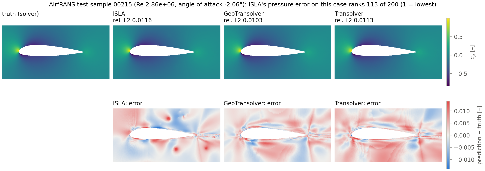
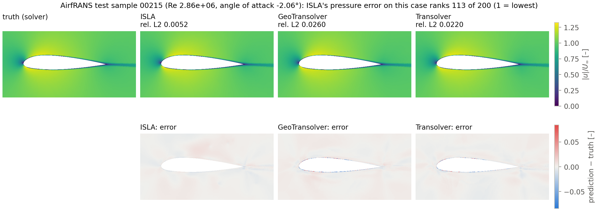

# AirfRANS {#sec-airfrans}

*Before this chapter:* the interior task, in which a model reads the boundary and predicts the field at points in the flow (@sec-interior-task); the scoring protocol (@sec-protocol) and the seed rule (@sec-fair-comparison); the rigid-motion contract (@sec-invariances).

```{python}
#| label: setup-airfrans
#| include: false
import json, re, statistics
from pathlib import Path
import sys; sys.path.insert(0, ".")
from palette import *
import standing as S
import records as R
_LZ = R.load("lre_az", "lreaz.json")   # LRE-AZ: the fixed Reynolds scale on AeroZoo's `reynolds` split
from matplotlib.collections import LineCollection
RES = Path("..") / "results"
J = lambda p: json.load(open(RES / p))
mean = statistics.mean
St = S.Standing("airfrans")
FIELDS = list(St.fields.items())          # [(metric key, label)]: pressure, velocity, eddy viscosity
BASE = S.BASELINES
N_TEST = St.cell("ISLA", "pressure_l2")["n_cases"]
N_SEEDS = St.cell("ISLA", "pressure_l2")["n_seeds"]
# the interior points per case in training and scoring, from the scorer of the standing's lanes
CELLS = int(re.search(r"CELLS=(\d+)", (RES / "campaigns_2026-10-14/afu/score.sbatch").read_text()).group(1))
# parameter counts, from the config line of each arm's own scoring record
nparams = lambda path: json.loads(open(RES / path / "native" / path.split("/")[-1] / "metrics.jsonl").readline())["num_parameters"]
DF = "campaigns_2026-10-19/drive_fix/scores/evals_afu_ud"
# the ISLA and ISLA-DTT runs of the standing file, seed 42 (isla_runs: "<evals>/<run stem>_seed{42,43}")
isla_run = lambda arm: St.raw["isla_runs"]["scores"].split("results/", 1)[1] + "/" + St.raw["isla_runs"][St.arm_names[arm]].replace("{42,43}", "42")
PARAMS = {"ISLA": nparams(isla_run("ISLA")), "ISLA-DTT": nparams(isla_run("ISLA-DTT")), "GeoTransolver": nparams(f"{DF}/afu_ud_gt_seed42"),
          "Transolver": nparams(f"{DF}/afu_ud_t_seed42")}
# the study records at the reference configuration (RECORDS.md beside them, under results/campaigns_2026-10-22/ and campaigns_2026-10-23/)
RM = R.load("probes090", "results/remesh_afeag/reduced_full.json")["seed_mean_ratio"]
RM_I, RM_D = RM["r090eag_af_isla"], RM["r090eag_af_dtt"]
FK = [f for f, _ in FIELDS]
remesh_dev = max(abs(RM_I[v][f] - 1) for v in ("refine2", "refine4", "refine31") for f in FK)
# the baselines' velocity error in the plane (x, y) against their scored three-component error, per seed, native mesh, the standing's arms
PL = J("campaigns_2026-10-19/drive_fix2/planar/planar_scores.json")
PLANAR_DEV = max(abs(xy / v3 - 1) for a in ("gt", "t") for v3, xy in zip(PL[f"afu_ud_{a}/native"]["velocity_l2"],
                                                                          PL[f"afu_ud_{a}/native"]["velocity_xy_l2"]))
COST = {a: S.cost("airfrans", a) for a in ("ISLA", "ISLA-DTT") + BASE}   # ISLA's and ISLA-DTT's on the fixed compiled path
def word(arch, f, p="native"):
    """ISLA against a baseline in the book's words: 'leads GeoTransolver 3.9x', 'trails Transolver (ratio 0.75)', 'is level with ...',
    'is not compared with ...'."""
    v, r = St.verdict(arch, f, p), St.ratio(arch, f, p)
    if v == "leads":
        return f"leads {arch} {S.fmt_ratio(r)}x" if r >= 2 else f"leads {arch} by {S.fmt_pct(r)}"
    if v == "trails":
        return f"trails {arch} (ratio {S.fmt_ratio(r)})"
    return f"{v} {arch}"
seeds_txt = lambda xs: ", ".join(f"{v:.4f}" for v in xs)
HELD = [f for f, _ in FIELDS if f in St.ds.provisional]   # fields given without a verdict (the registry's provisional entry)
CMP = [(f, l) for f, l in FIELDS if f not in HELD]          # the fields with a verdict
both = lambda f: (f"{word('GeoTransolver', f)} and {word('Transolver', f)}")
```

```{python}
#| label: para-airfrans-lede
#| output: asis
isla_posed = max(abs(St.shift("ISLA", f, "posed") - 1) for f, _ in FIELDS)
print(f"**On the AirfRANS interior task ISLA " + "; it ".join(f"{both(f)} on {l}" for f, l in CMP)
      + "".join(f"; its {St.fields[f]} carries no verdict" for f in HELD)
      + f". Its error moves by at most {isla_posed * 100:.2f}% when every case is rotated and translated, and by at most "
      f"{remesh_dev * 100:.2f}% when the airfoil is re-panelized exactly.** " + ("The ISLA rows of the standing carry an In-flight note "
      "(@sec-interior-airfrans). " if St.in_flight else ""), end="")
print("AirfRANS is the book's two-dimensional flow dataset, and its one global input is the inlet velocity. The chapter shows "
      "the problem, what is measured, the standing of the three reference configurations with ISLA-DTT and GLOBE beside them, the studies "
      "that belong to this dataset (on smaller instruments, the training-airfoil ladder and the read-only prediction points; at the "
      "reference configuration, extrapolation in Reynolds number and angle of attack, which of ISLA's components carry its accuracy here, "
      "the dependence on the query population and on the boundary's discretization), and ends with what the "
      "dataset does not say. Every ratio between ISLA's and a baseline's test error is baseline ÷ ISLA.")
```

## The problem: NACA airfoils across Reynolds number and incidence {#sec-dataset-airfrans}

**Each AirfRANS case is a two-dimensional incompressible RANS solution around one NACA airfoil, and the model must recover the whole flow field from the airfoil's outline and the inlet condition.** The source (Bonnet et al., 2022) holds 1,000 solutions with the $k$–$\omega$ SST closure, at Reynolds numbers of 2 to 6 million and angles of attack of −5° to 15°. The boundary is the airfoil polyline: about a thousand line segments, each with an outward normal and its length as the measure weight $w_i$ (the length the segment stands for in every boundary integral). The inlet velocity closes the problem. Its direction is the one *global vector* $\hat g_1$, a unit vector at the angle of attack; its speed $U_\infty$ sets the Reynolds number with the chord and the air's kinematic viscosity, which is the same on every case. The *prediction points* are points of the stored interior mesh; at each one the model predicts pressure, velocity and the eddy viscosity of the turbulence model. @fig-problem-airfrans shows one test case.

```{python}
#| label: fig-problem-airfrans
#| fig-cap: >
#|   The AirfRANS problem, on one test airfoil. Top: what the model is given,
#|   the airfoil polyline with its outward normals (every twelfth drawn), the
#|   inlet direction $\hat g_1$ (black arrow, the global vector) and the inlet
#|   speed $U_\infty$; the printed window is where the prediction
#|   points lie. Middle: the pressure coefficient
#|   $C_p = p / \tfrac{1}{2} U_\infty^2$ (kinematic pressure) at the interior
#|   mesh points near the airfoil. Bottom: the speed ratio $|U| / U_\infty$ at
#|   the same points. How to read this: colors are the reference CFD fields,
#|   not predictions; the dots are 70,000 of the case's interior points, and
#|   their density follows the mesh, fine at the wall and in the wake; the
#|   domain extends far beyond this window. Data:
#|   results/problem_figures_2026-09-22/airfrans.npz.
#| code-fold: true
A, Am = load_problem("airfrans")
bp, bc, bn = A["bnd_points"], A["bnd_cells"], A["bnd_normals"]; mid = bp[bc].mean(axis=1)
ip = A["int_points"]
fig, axes = plt.subplots(3, 1, figsize=(8, 7.2), sharex=True, gridspec_kw=dict(hspace=0.22))
ax = axes[0]
ax.add_collection(LineCollection(bp[bc][:, :, :2], colors=BC["free"], linewidths=2.0, zorder=3))
k = slice(None, None, 12); ax.quiver(mid[k, 0], mid[k, 1], bn[k, 0], bn[k, 1], color=MUTED, scale=28, width=0.0025, headwidth=3, zorder=2)
u = A["U_inf_dir"]; ax.annotate("", xy=(-0.45 + 0.3 * u[0], 0.38 + 0.3 * u[1]), xytext=(-0.45, 0.38), arrowprops=dict(arrowstyle="-|>", color=INK, lw=2.0))
ax.text(-0.1, 0.40, f"inlet along $\\hat g_1$ at {Am['aoa_deg']:.2f}° (the global vector); $U_\\infty$ = {Am['U_inf_mag']:.1f} m/s; Re = {Am['Re'] / 1e6:.1f} million", ha="left", va="center", fontsize=8.5, color=INK2)
ib = A["interior_bbox"]
map_axes(ax); ax.set_xlim(-0.5, 1.5); ax.set_ylim(-0.55, 0.55); ax.set_ylabel("y / chord [–]")
ax.set_title(f"the boundary: {Am['n_boundary_cells']:,} line segments (position, normal, length), a no-slip wall; prediction points fill {ib[0,0]:.0f} < x < {ib[1,0]:.0f}, {ib[0,1]:.0f} < y < {ib[1,1]:.0f} chords", fontsize=9.2)
cb0 = fig.colorbar(mpl.cm.ScalarMappable(cmap=SEQUENTIAL), ax=ax, fraction=0.035, pad=0.02); cb0.ax.set_visible(False)   # aligns the panels
ax = axes[1]
sc = field_scatter(ax, ip[:, :2], A["int_cp"], s=2.5, signed=True, vmin=-1.0, vmax=1.0); map_axes(ax); ax.set_ylim(-0.55, 0.55)
ax.add_collection(LineCollection(bp[bc][:, :, :2], colors=INK, linewidths=0.8, zorder=3)); ax.set_ylabel("y / chord [–]")
ax.set_title("pressure coefficient $C_p$ at the interior points (target)", fontsize=9.5)
small_colorbar(fig, sc, ax, "$C_p$ [–]", extend="both")
ax = axes[2]
sc = field_scatter(ax, ip[:, :2], A["int_umag"], s=2.5, vmin=0, vmax=1.3); map_axes(ax); ax.set_ylim(-0.55, 0.55)
ax.add_collection(LineCollection(bp[bc][:, :, :2], colors=WHITE, linewidths=0.8, zorder=3)); ax.set_ylabel("y / chord [–]"); ax.set_xlabel("x / chord [–]")
ax.set_title("speed ratio $|U| / U_\\infty$ at the interior points (target)", fontsize=9.5)
small_colorbar(fig, sc, ax, "$|U| / U_\\infty$ [–]", extend="max")
plt.show()
```

```{python}
#| label: para-airfrans-samples
#| output: asis
As_, Asm = load_samples("airfrans")
cs = Asm["cases"]; tr = Asm["test_ranges"]; Us = [c["U_inf_mag"] for c in cs]
print(f"**Across the set, the airfoil, the inlet direction and the inlet speed all change together.** @fig-airfrans-samples shows six of the "
      f"{Asm['n_test']} test cases: the four corners of the (Reynolds number, angle of attack) rectangle, which over the test set runs from "
      f"Re = {tr['Re'][0] / 1e6:.1f} to {tr['Re'][1] / 1e6:.1f} million and from {tr['aoa_deg'][0]:.1f}° to {tr['aoa_deg'][1]:.1f}°, and the two "
      f"cases nearest its center, one four-digit and one five-digit NACA section. The inlet speed runs from {min(Us):.0f} to {max(Us):.0f} m/s "
      "across the six, and every case has its own mesh.")
```

```{python}
#| label: fig-airfrans-samples
#| fig-cap: >
#|   Six AirfRANS test cases at the corners and the center of the (Reynolds
#|   number, angle of attack) range: the speed ratio $|U| / U_\infty$ at the
#|   interior mesh points near the airfoil (35,000 of each case's points), the
#|   airfoil in white and the inlet direction $\hat g_1$ as a black arrow; the
#|   Reynolds number, the angle, the inlet speed and the NACA family are printed
#|   per panel, on one color scale for all six. How to read this: the top and
#|   bottom rows are the corners, low Reynolds number on the left and high on
#|   the right, low angle on top and high at the bottom; the middle row holds
#|   the two cases nearest the center; as the angle rises the
#|   stagnation point moves under the nose and the wake thickens and tilts,
#|   which the model must learn from the direction vector alone; colors are the
#|   reference CFD field, not predictions. Data:
#|   results/sample_figures_2026-10-02/airfrans.npz.
#| code-fold: true
io = As_["int_offsets"]; po = As_["bnd_point_offsets"]; co = As_["bnd_cell_offsets"]
fig, axes = plt.subplots(3, 2, figsize=(8, 8.8), sharex=True, sharey=True, gridspec_kw=dict(hspace=0.3, wspace=0.05))
for i, c in enumerate(cs):
    ax = axes[i // 2, i % 2]
    ip = part(As_["int_points"], io, i); um = part(As_["int_umag"], io, i)
    bp = part(As_["bnd_points"], po, i); bc = part(As_["bnd_cells"], co, i)
    sc = field_scatter(ax, ip[:, :2], um, s=2.2, vmin=0, vmax=1.3); map_axes(ax)
    ax.add_collection(LineCollection(bp[bc][:, :, :2], colors=WHITE, linewidths=0.9, zorder=3))
    u = As_["U_inf_dir"][i]; ax.annotate("", xy=(-0.4 + 0.25 * u[0], 0.4 + 0.25 * u[1]), xytext=(-0.4, 0.4), arrowprops=dict(arrowstyle="-|>", color=INK, lw=1.8))
    ax.text(-0.1, 0.42, f"$\\hat g_1$ at {c['aoa_deg']:.1f}°", ha="left", va="center", fontsize=7.8, color=INK, path_effects=halo())
    ax.set_xlim(-0.5, 1.6); ax.set_ylim(-0.6, 0.6)
    ax.set_title(f"Re = {c['Re'] / 1e6:.1f} million, $\\alpha$ = {c['aoa_deg']:.1f}°\n$U_\\infty$ = {c['U_inf_mag']:.0f} m/s, NACA {'five' if c['naca_five_digit'] else 'four'}-digit section", fontsize=8.3)
    if i % 2 == 0: ax.set_ylabel("y / chord [–]")
    if i // 2 == 2: ax.set_xlabel("x / chord [–]")
cb = fig.colorbar(sc, ax=axes, fraction=0.02, pad=0.01, extend="max"); cb.set_label("$|U| / U_\\infty$ [–]"); cb.outline.set_visible(False)
plt.show()
```

The geometry family is narrow: smooth airfoils of one parameterization, in a planar flow. AirfRANS therefore tests how a model reads its global inputs more than how it reads geometry; AeroZoo (@sec-aerozoo) is the dataset for geometry.

### Files, conversion and normalization {#sec-data-airfrans}

**The release is converted once from VTK into the recipe's mesh format, and the targets are made dimensionless by the inlet condition.** Each case directory of the release, `airFoil2D_SST_<speed>_<aoa>_<NACA parameters>`, holds an `_internal.vtu` interior of about 177,000 cells with velocity `U`, pressure `p`, eddy viscosity `nut` and the signed distance `implicit_distance` at the points, an `_aerofoil.vtp` polyline and a `_freestream.vtp` far boundary. The chord is 1 m and the kinematic viscosity 1.56e-5 m²/s.

- **Conversion** (`airfrans_convert.py`, @tbl-data-files). The interior becomes a point cloud with `velocity`, `pressure`, `nut`, `sdf` (the stored signed distance, positive outside the airfoil) and `sdf_normals`, the in-plane unit vector from the nearest airfoil point. The boundary `airfoil` is line cells with in-plane outward normals and the segment lengths as `quadrature_measure`. `global_data` holds `U_inf` (parsed from the case name and checked against the far boundary), `U_inf_dir`, `U_inf_mag`, `aoa_deg`, `Re` and the NACA parameters.
- **Normalization** (`airfrans_uvolume_2d.yaml`). Pressure is kinematic ($\rho_\infty = 1$, $p_\infty = 0$) and divided by $\tfrac{1}{2} U_\infty^2$; velocity is divided by $U_\infty$; `nut` keeps its units and is standardized (mean 7.9e-4 m²/s, standard deviation 2.4e-3 m²/s, from the converter's per-case statistics). These targets are every model's. ISLA's configuration declares the velocity and the pressure dimensionless, since they are already divided by $U_\infty$, its velocity scale, and `nut` in the units $U L$: the head predicts $\nu_t / (c\, U L)$, with the constant $c$ fitted on the training airfoils, and the model returns $c\, \hat y\, U L$ standardized by the same constants as the target (@sec-using-scales).
- **The interior draw.** The reader takes each case whole and the first transform keeps a uniform random subset of the interior points (`SubsampleMesh`). The stored points run through space in the solver's order, so a uniform draw is needed to cover the domain.
- **Splits** (the release's manifest, unchanged). `full`: 800 train / 200 test; `scarce`: 200 train; `reynolds`: 504 / 496, an extrapolation in Reynolds number; `aoa`: 804 / 196, an extrapolation in angle of attack. The training-airfoil ladder uses nested subsets of 50 to 400 airfoils inside `full` (@sec-airfrans-ladder).

```{python}
#| label: para-airfrans-domain-boundary
#| output: asis
AFW = {r_["quantity"]: r_ for r_ in R.md_table("af_whole", "PREREG.md", "3. Facts before training")}
AF_CROP = re.search(r"nodes in about (\[[^\]]+\] x \[[^\]]+\]) chords", " ".join(R.load("boundary_audit", "REPORT.md").split())).group(1)
ff = AFW["far field"]["airfoil + far field (W)"]
L_af, L_w = (AFW["ISLA's L (`ISLA._gauge`, float64)"][k] for k in ("airfoil only (standing)", "airfoil + far field (W)"))
print("- **The domain's boundary.** The converted files store the airfoil alone, and their interior is the release's own crop, about "
      f"{AF_CROP.replace(' x ', ' × ')} chords; the crop's edges are not a boundary of the PDE, since the flow crosses them and no "
      "condition is stored on them. The far field is only in the release's `_freestream.vtp`: on every case "
      f"{re.match(r'[\d,]+-[\d,]+ segments', ff).group(0).replace('-', ' to ')}, a half circle of radius 200 chords upstream closed "
      "by the lines $x = 200$ and $y = \\pm 200$ downstream. ISLA's configuration reads the far field as well, as the "
      "condition `freestream` with no field (its prescribed value is the inlet velocity ISLA already reads); the "
      "standing's checkpoints were trained with the airfoil alone (@sec-standing-geometry). With the far field "
      "ISLA's length unit $L$, the RMS pairwise distance of the given "
      f"boundary, is {re.search(r'[\d.]+', L_w).group(0)} chords on every case, against "
      f"{L_af.split(' (')[0].replace('-', ' to ')} chords with the airfoil alone. Data: {R.source('af_whole', 'PREREG.md')} (section 3), {R.source('boundary_audit', 'REPORT.md')} (section 5).")
```

## What is measured {#sec-airfrans-measured}

```{python}
#| label: para-airfrans-measured
#| output: asis
print(f"**The interior task on the `full` split: 800 training airfoils, {N_TEST} test airfoils, {CELLS:,} interior points per case, 500 epochs, "
      f"{['no', 'one', 'two', 'three'][N_SEEDS]} seeds, float32 scoring.** The {CELLS:,} points are about half of each case's stored interior points, drawn uniformly at random "
      "in training and in scoring. The metric is the per-case relative L2 per field averaged over the test cases (@sec-metrics). Eddy viscosity "
      "is standardized before scoring, so its ratios order the models but are not physical percentages. The three architectures run at their "
      "reference configurations, the same on every dataset of the book (@sec-selection, @tbl-architectures):")
print()
# ISLA with 128 slices against this standing's 512 (registered reading: results/campaigns_2026-10-23/slices_af/RESULTS.md)
SL = R.load("slices_af", "reading.json")["native"]
SLC = {r_["measure"].split(",")[0]: R.num(r_["S ÷ B"]) for r_ in R.md_table("slices_af", "RESULTS.md", "R3, cost")}
assert all(SL[f]["label"] == "no change" for f in FK)
print(f"- **ISLA**: width 512, 12 layers, 512 slices, learning rate 3.75e-4, {PARAMS['ISLA'] / 1e6:.1f}M parameters; the slice sublayer reads "
      "the normalized token state (@sec-isla-layer). With 128 slices in place of 512, its test errors are "
      + " / ".join(f"{SL[f]['ratio']:.3f}" for f in FK) + " of this configuration's on " + " / ".join(l for _, l in FIELDS)
      + " (ratios of arithmetic seed means, two seeds each; no field moves by the rule registered for the test) at "
      f"{SLC['smoke 354977']:.2f} of the training step and {SLC['smoke: peak allocated per rank']:.2f} of the peak memory, "
      "so the reference keeps 512 and 128 is a cheaper setting that costs interacting ISLA nothing measurable here or on the "
      "DrivAerML Volume task, and is untested on ISLA-DTT (@sec-oq-slices). "
      f"Data: {R.source('slices_af', 'RESULTS.md')}.")
print(f"- **ISLA-DTT**: the same configuration with read-only prediction points, {PARAMS['ISLA-DTT'] / 1e6:.1f}M parameters "
      "(@sec-airfrans-dtt-reference).")
print(f"- **GeoTransolver**: width 256, learning rate 1e-3, {PARAMS['GeoTransolver'] / 1e6:.1f}M parameters.")
print(f"- **Transolver**: width 512, 16 layers, learning rate 1e-3, {PARAMS['Transolver'] / 1e6:.1f}M parameters.")
print()
print("No model trains with rotation or translation augmentation. **The three do not receive the same inputs** (@tbl-airfrans-inputs): "
      "GeoTransolver and Transolver never see the airfoil, only a signed distance to it stored at every point.")
```

| | boundary | global inputs | at each prediction point |
|---|---|---|---|
| ISLA | the airfoil polyline, the one condition `airfoil`: each segment's position, normal and length; the far field, the rest of the domain's boundary, is not given to the standing's models, and ISLA's configuration reads it as the condition `freestream` (@sec-data-airfrans) | the inlet velocity `U_inf` (rank 1), which defines the velocity scale: its direction is $\hat g_1$ and its magnitude the velocity scale $U = U_\infty$; the one global scalar, `re_z`, is the standardized $\log_{10}(U L / \nu)$, which the recipe computes in ISLA's configuration from $U$, the length unit $L$ and the air's kinematic viscosity, a constant of the configuration (@sec-using-scales) | position, entering only through relational invariants; the exact signed distance and direction to the full-resolution airfoil, computed inside the model |
| GeoTransolver | none | $\hat g_1$ and the inlet speed standardized over the 800 training airfoils, read by the context projector | coordinates; the stored `sdf` and `sdf_normals` |
| Transolver | none | the same two, concatenated to every point's features | coordinates; the stored `sdf` and `sdf_normals` |

: What each architecture receives on the AirfRANS interior task. How to read this: only ISLA reads the airfoil itself; the baselines read the stored signed distance, computed by the converter from the full airfoil, and ISLA computes the same quantity itself from the airfoil it is given and reads no stored field, by Peter's boundary-only input ruling (@sec-arch-interior-geometry); ISLA-DTT receives what ISLA receives; the global column carries the same information for all three: the baselines read the direction and the speed standardized to a scale of one, ISLA the direction and the Reynolds number its declared scales form; the baselines read the planar case embedded in three dimensions, with a third coordinate and a third velocity component. Data: conf/model/isla_volume_airfrans.yaml of the recipe, the two baselines' recipe configurations (@sec-baselines) and results/campaigns_2026-10-19/drive_fix/PREREG.md. {#tbl-airfrans-inputs}

```{python}
#| label: para-airfrans-scorings
#| output: asis
step_ratio = COST["ISLA"]["step_seconds"] / mean(COST[a]["step_seconds"] for a in BASE)
print("**Each checkpoint is scored twice on the same test cases**: on the native mesh, and with every case rotated in its plane and "
      "translated by one RMS point radius, the inlet direction rotated with it (@sec-pose). The uniform-point-cloud scoring of the surface "
      "datasets is not shown: the airfoil has fewer segments than the scoring budget and the interior points carry no cells, so at that budget "
      "it returns the native mesh. The boundary's discretization is measured directly instead (@sec-airfrans-discretization).")
print()
g = {(c["gpus"], c["precision"]) for c in COST.values()}
print("**Cost.** One training step of each reference configuration, ISLA's and ISLA-DTT's on the compiled training "
      "path after its fault was fixed (the standing's ISLA and ISLA-DTT checkpoints trained without compilation), " + " and ".join(f"on {n} GB300 GPUs in {pr}" for n, pr in sorted(g))
      + " (allocator peak per GPU, the maximum over ranks; median step): "
      + "; ".join(f"{a} {v['peak_gib']:.0f} GiB and {v['step_seconds']:.2f} s" for a, v in COST.items())
      + f". ISLA's step is {step_ratio:.1f} times the baselines' mean on this planar task. The ISLA lanes priced here compile its blocks one by one, and "
      "the baselines run uncompiled, as released (@tbl-ref-cost). Data: results/char/" + S.COST_FILE + ".")
```

## The standing {#sec-interior-airfrans}

```{python}
#| label: para-airfrans-standing-lede
#| output: asis
print("**ISLA " + "; it ".join(f"{both(f)} on {l}" for f, l in CMP)
      + "".join(f"; {St.fields[f]} is given without a verdict" for f in HELD) + ".** The words follow the seed rule: ISLA leads or trails "
      f"only when every seed of one model lies beyond every seed of the other and the seed means differ by at least {100 * S.TIE_BAND:.0f}%. "
      "@tbl-airfrans-protocols holds the numbers.")
if HELD:
    print()
    print(f"**{' and '.join(St.fields[f] for f in HELD)} carries no verdict:** {'; '.join(St.ds.provisional[f] for f in HELD)}.")
print()
print("**Velocity is measured alike for the three.** GeoTransolver and Transolver predict the planar flow as three velocity "
      "components, and their velocity error is scored on all three; scored on the two in-plane components alone, on the same "
      f"checkpoints, it differs by at most {100 * PLANAR_DEV:.4f}% on the native mesh, so the ratios read the same under either "
      "definition. Data: results/campaigns_2026-10-19/drive_fix2/planar/planar_scores.json.")
```

```{python}
#| label: out-tbl-airfrans-protocols
#| output: asis
print(St.table("tbl-airfrans-protocols", f"The AirfRANS interior task (ISLA: interacting ISLA 0.9.0; ISLA-DTT: ISLA-DTT 0.9.0), `full` split, {N_TEST} test airfoils"))
print(S.form_callout("its row here is ISLA-DTT 0.9.0, whose error is " + " / ".join(f"{St.ratio('ISLA-DTT', f):.3f}" for f in FK)
                     + " times interacting ISLA's on " + " / ".join(l for _, l in FIELDS),
                     what="interacting ISLA 0.9.0 and ISLA-DTT 0.9.0 reading the airfoil alone (trained with the far field as well, "
                          "both read a harm: @sec-limits-af-whole)"))
```

```{python}
#| label: para-airfrans-dtt-standing
#| output: asis
dtt_r = {f: St.err("ISLA-DTT", f) / St.err("ISLA", f) for f in FK}
def dtt_word(f):
    """ISLA-DTT against ISLA on one field by the seed rule (standing.Standing.verdict)."""
    d, i = St.seeds("ISLA-DTT", f), St.seeds("ISLA", f)
    if abs(dtt_r[f] - 1) < S.TIE_BAND:
        return "level with ISLA"
    return "behind ISLA" if min(d) > max(i) else "ahead of ISLA" if max(d) < min(i) else "level with ISLA"
print(f"**ISLA-DTT, the same configuration with read-only prediction points, is " + ", ".join(f"{dtt_word(f)} on {l}" for f, l in FIELDS)
      + " by the seed rule: ISLA-DTT ÷ ISLA is " + " / ".join(f"{dtt_r[f]:.3f}" for f in FK) + " on " + " / ".join(l for _, l in FIELDS)
      + ", a ratio of arithmetic seed means.** Against the baselines it reads " + "; ".join(f"{a} ÷ ISLA-DTT " + " / ".join(f"{St.err(a, f) / St.err('ISLA-DTT', f):.2f}" for f in FK)
                                                        for a in BASE)
      + f". Both forms keep their native error to within {100 * max(abs(St.shift(a, f, 'posed') - 1) for a in S.ISLA_FORMS for f in FK):.2f}% "
      "when every case is rotated and translated. @sec-airfrans-dtt-reference says what the bundle of ISLA's components does to each form.")
```

```{python}
#| label: para-airfrans-reading
#| output: asis
b_shift = [St.shift(a, f, "posed") for a in BASE for f, _ in FIELDS]
b_posed_err = [St.err(a, f, "posed") for a in BASE for f, _ in FIELDS]
V = S.Standing("drivaerml_volume")
print(f"**Against the cars.** On the DrivAerML Volume task GeoTransolver ÷ ISLA is {V.ratio('GeoTransolver', 'pressure_l2'):.2f} on "
      f"pressure and {V.ratio('GeoTransolver', 'nut_l2'):.2f} on eddy viscosity (@sec-interior-results); here it is "
      f"{St.ratio('GeoTransolver', 'pressure_l2'):.2f} and {St.ratio('GeoTransolver', 'nut_l2'):.2f}. The two datasets differ "
      "in what pressure is (gauge pressure on a three-dimensional body against a pressure coefficient in planar incompressible flow) and "
      "in what the boundary is (200,000 sampled cells of a car against a polyline of about a thousand segments).")
print()
print(f"**Under rotation and translation ISLA's error is its native error, and the baselines' errors pass the score of predicting zero.** "
      f"ISLA's largest shift on any field is {max(abs(St.shift('ISLA', f, 'posed') - 1) for f, _ in FIELDS) * 100:.2f}% of its native error. "
      f"GeoTransolver's and Transolver's posed errors are {S.fmt_ratio(min(b_shift))} to {S.fmt_ratio(max(b_shift))} times their own native "
      f"errors, every one of the six at or above {min(b_posed_err):.2f}, worse than predicting zero everywhere. They read raw "
      "coordinates and never trained on a rotated airfoil, so a rotated airfoil is outside their training distribution even though the "
      "inlet direction rotates with it.")
```

```{python}
#| label: out-fig-airfrans-prediction
#| output: asis
#| column: page
RD = json.load(open(RENDER_DIR_090 / "render_2d_airfrans.json"))["airfrans"]
PE = RD["per_sample_rel_l2"]
_src = next(v for k, v in RD["source"].items() if k.endswith("_isla/native"))
_rec = RES / "campaigns_2026-10-22/standing_090/scores" / _src["scorer_record"].removeprefix("$T/")
_e = {r["sample_id"]: r["metrics"]["pressure_l2"] for r in map(json.loads, open(_rec)) if r.get("phase") == "infer_step"}
_rk = sorted(_e, key=_e.get).index(RD["sample_id"]) + 1

print("::: {#fig-airfrans-prediction layout-nrow=2}\n")
print("\n")
print("\n")
print(f"The three reference configurations on one held-out AirfRANS airfoil, {RD['sample_id'].split('_')[0]} (Reynolds number "
      f"{RD['Re'] / 1e6:.2f} million, angle of attack {RD['aoa_deg']:.1f}°), from the standing's checkpoints (seed 42): ISLA at its "
      "reference configuration, trained eagerly as in the standing, and the baselines reading the inlet direction as a unit vector "
      "and the inlet speed standardized (@sec-unit-direction-rule). All three are scored and drawn on the same "
      f"{RD['n_points_scored']:,} points. Relative L2 on this case: {case_errors(PE)}; the airfoil ranks {_rk} of {len(_e)} by ISLA's "
      "pressure error over the test airfoils. Top row of each panel: the solver's field and each model's prediction on one color "
      "scale; bottom row: prediction minus solver, on one symmetric scale. How to read this: one case, not a standing; the standing "
      "is @tbl-airfrans-protocols. Data: results/renderings_2026-10-22/arrays/render_2d_airfrans.json and airfrans_00215.npz.\n")
print(":::")
```

### GLOBE on the same task {#sec-airfrans-globe}

```{python}
#| label: para-airfrans-globe
#| output: asis
GL = S._load("globe_airfrans")
G_PTS = int(re.search(r"trained on ([\d,]+) points per step", GL["protocol"]).group(1).replace(",", ""))
g_err = {f: GL["arms"]["GLOBE"]["native"][f]["mean"] for f in FK}
g_pose = max(abs(v - 1) for f in FK for v in GL["posed_over_native"][f].values())
g_over = {a: {f: GL["over_baselines"][St.arm_names[a]]["native"][f]["mean"] for f in FK} for a in BASE}
g_isla = {f: GL["over_isla"]["native"][f]["mean"] for f in FK}
print(f"**GLOBE (@sec-landscape-globe), the learned boundary integral on a Barnes–Hut tree, scores " + " / ".join(f"{g_err[f]:.4f}" for f in FK)
      + " on " + " / ".join(l for _, l in FIELDS) + " on the same test airfoils, and keeps its native error to within "
      f"{100 * g_pose:.3f}% when every case is rotated and translated.** It runs at its published configuration and trains on {G_PTS:,} "
      f"interior points per step, against the {CELLS:,} of the three reference configurations; every arm is scored on the same "
      f"{CELLS:,}-point draw. GLOBE ÷ baseline is " + "; ".join(f"{' / '.join(f'{g_over[a][f]:.2f}' for f in FK)} against {a}" for a in BASE)
      + ": below one GLOBE is the more accurate. GLOBE ÷ ISLA is "
      + " / ".join(f"{g_isla[f]:.2f}" for f in FK) + f". Data: results/char/{S.EXTRA['globe_airfrans']}.")
w = GL["over_isla"]["in_flight"]
if GL["over_isla"]["status"] == "in_flight":
    print()
    print(S.in_flight_callout({"what": f"GLOBE's error divided by that of {w['what']}",
                               "replacement": f"GLOBE's error divided by that of {w['replacement'][0].lower() + w['replacement'][1:]}"}))
```

## Studies on this dataset {#sec-airfrans-ladders}

**Two studies on this dataset use smaller ISLA configurations than the reference one; they are read for slopes and mechanisms, never as standings.** Each caption names its instrument in the tag of @sec-study-configurations. The training-airfoil ladder's baseline is *GeoTransolver-volume*, the GeoTransolver of the DrivAerML Volume task with its ball-query local features on (@sec-baselines), at width 256 and learning rate 1e-3, where the standing uses the reference GeoTransolver. Unlike the standing's baselines it reads the inlet velocity as the physical vector in m/s (@sec-unit-direction-rule), so a comparison with it carries that input difference and is a statement about these two configurations. Both studies read the interior points as contiguous blocks of the stored rows, a spatially coherent window of the domain rather than a uniform sample, in training and in scoring alike. The comparisons inside each study are like for like; their absolute errors are not comparable with @tbl-airfrans-protocols. The other studies are at the reference configuration: on ISLA and ISLA-DTT trained on the compiled training path after its fault was fixed, the two forms against each other (@sec-airfrans-dtt-reference), extrapolation (@sec-interior-extrapolation) and which components carry ISLA's accuracy (@sec-airfrans-attribution); on the standing's checkpoints, trained without compilation, the request's population (@sec-airfrans-query-population) and the boundary's discretization (@sec-airfrans-discretization).

### The training-airfoil ladder {#sec-airfrans-ladder}

```{python}
#| label: para-airfrans-ladder
#| output: asis
AFS = J("airfrans_scale_2026-09-22.json"); AFF = AFS["fits"]; ORD = AFS["bars"]["ordering"]["pressure_l2"]["per_rung"]
a_p, a_v = AFF["isla|pressure_l2"]["fit"]["alpha"], AFF["isla|velocity_l2"]["fit"]["alpha"]
gt_loc = [v for k, v in AFF["gt|pressure_l2"]["local_alpha"].items() if int(k.split("-")[0]) >= 100]
print(f"**On AirfRANS no error floor is in reach at 800 airfoils: ISLA's error falls as a clean power law in the number of "
      f"training airfoils.** The ladder trains ISLA and GeoTransolver-volume on nested subsets of "
      f"50, 100, 200, 400 and 800 airfoils, two seeds each "
      f"(@fig-scaling-airfrans). ISLA's error falls as a clean power law $\\varepsilon \\propto n^{{-b}}$ in the number of training airfoils "
      f"$n$, with the data exponent $b$ = {a_p:.2f} on pressure and {a_v:.2f} on velocity. GeoTransolver-volume's local pressure exponent is "
      f"{min(gt_loc):.2f} to {max(gt_loc):.2f} from 100 airfoils up, and its 50-airfoil error sits above its own trend, so no fit is accepted for it; "
      "it reads the inlet velocity as the physical vector, so its curve is drawn for reference and the two are not compared. One consequence "
      "follows for the compute-allocation rule of @sec-compute-allocation, which splits a fixed training budget between more cases and more "
      "parameters by comparing the data exponent with the parameter exponent. This ladder trains one width and so measures only the data "
      "exponent; what it gives that rule is that no floor limits what more training cases buy ISLA across the range measured here.")
```

```{python}
#| label: fig-scaling-airfrans
#| fig-cap: >
#|   Interior error against training airfoils on the AirfRANS interior task:
#|   pressure (left), velocity (middle) and eddy viscosity (right, a
#|   standardized field), two-seed means with the seeds as short bars, float32
#|   on the 200 test airfoils, 500 epochs at 100,000 interior points. ISLA in
#|   blue squares, GeoTransolver-volume (learning rate 1e-3, reading the inlet
#|   velocity as the physical vector, not compared) in red circles.
#|   Dotted curves are fits of $\varepsilon = \varepsilon_\infty + a
#|   n^{-b}$, drawn only where the fit's RMS relative residual is below 3%;
#|   other series carry their local exponents from 100 airfoils up. Instrument:
#|   ISLA at 192 wide, 256 slices, 1e-3, raw slice reads
#|   (@sec-study-configurations); interior points read as contiguous blocks of
#|   the stored rows. How to read this: the slope of a run of points is its
#|   data exponent; the levels are those of the instrument, not the standing,
#|   and there is no parameter axis; both axes are logarithmic. Data:
#|   results/airfrans_scale_2026-09-22.json.
#| fig-alt: "Three log-log panels of interior error against training airfoils from 50 to 800: ISLA in blue squares with dotted fitted lines on pressure and velocity, GeoTransolver-volume in red circles as points only, each series labeled at its right end with its exponent b."
#| code-fold: true
AC = AFS["configurations"]
fig, axes = plt.subplots(1, 3, figsize=(11.0, 3.9), sharex=True)
nn = np.geomspace(45, 900, 100)
AC_last = {f: [max(((c["n"], c[f]["mean"]) for c in AC.values() if c["arm"] == m and c["status"] == "complete" and f in c))
               for m in ("isla", "gt")] for f in ("pressure_l2", "velocity_l2", "nut_l2")}
for ax, (f, lab) in zip(axes, (("pressure_l2", "interior pressure"), ("velocity_l2", "interior velocity"), ("nut_l2", "interior eddy viscosity"))):
    for m, key in (("isla", "isla_ref"), ("gt", "gt")):
        kw = series_kwargs(key)
        rows = sorted([(c["n"], c[f]["mean"], c[f]["seeds"]) for c in AC.values() if c["arm"] == m and c["status"] == "complete" and f in c])
        ax.plot([r[0] for r in rows], [r[1] for r in rows], marker=kw["marker"], color=kw["color"], ls="none", ms=6)
        for r in rows:
            ax.plot([r[0]] * len(r[2]), r[2], ls="none", marker="_", color=kw["color"], ms=7, mew=1.1)
        F = AFF[f"{m}|{f}"]["fit"]; accepted = F["rms_rel_residual"] < 0.03
        loc = AFF[f"{m}|{f}"]["local_alpha"]; tail = [v for k, v in loc.items() if int(k.split("-")[0]) >= 100]
        if accepted:
            ax.plot(nn, F["eps_inf"] + F["a"] * nn ** (-F["alpha"]), color=kw["color"], ls=":", lw=1.1, zorder=0)
            lab_a = f"b = {F['alpha']:.2f} (fit)"
        else:
            lab_a = f"local b {min(tail):.2f} to {max(tail):.2f}"
        name = "ISLA" if m == "isla" else "GeoTransolver-\nvolume"
        up = rows[-1][1] >= max(r[1] for r in AC_last[f])   # the upper series is labeled above its last point, the lower below
        ax.annotate(f"{name}\n{lab_a}", xy=(rows[-1][0], rows[-1][1]), xytext=(9, 5 if up else -5), textcoords="offset points",
                    fontsize=8.4, color=kw["color"], va="bottom" if up else "top", ha="left", path_effects=halo())
    ax.set_xscale("log"); ax.set_yscale("log"); ax.set_xticks([50, 100, 200, 400, 800]); ax.set_xticklabels(["50", "100", "200", "400", "800"])
    ax.xaxis.set_minor_formatter(mpl.ticker.NullFormatter()); ax.yaxis.set_minor_formatter(mpl.ticker.NullFormatter())
    ax.set_yticks([0.02, 0.03, 0.05, 0.1, 0.2]); ax.set_yticklabels(["0.02", "0.03", "0.05", "0.10", "0.20"]); ax.set_xlim(42, 3600)
    ax.set_xlabel("training airfoils [count]"); ax.set_ylabel(f"{lab} relative L2 error [–]")
plt.tight_layout(); plt.show()
```

### Read-only prediction points {#sec-airfrans-read-only}

```{python}
#| label: para-airfrans-read-only-data
#| include: false
# The read-only controls are reported in research/dtt/REPORT.md: the "E5 interim" table (passive without a read, dense global read)
# and the "Pose-free parity on AirfRANS" table (ISLA-DTT, the forest in the boundary's own frame). Each row: seed 42, seed 43,
# seed mean, each "pressure / velocity / eddy viscosity".
REPORT = (Path("..") / "research" / "dtt" / "REPORT.md").read_text().splitlines()
def report_row(section, prefix):
    start = next(i for i, l in enumerate(REPORT) if l.startswith(section))
    line = next(l for l in REPORT[start:] if l.startswith(f"| {prefix} |"))
    cells = [c.strip() for c in line.strip().strip("|").split("|")]
    return [[float(x) for x in c.split(" / ")] for c in cells[1:4]]
K_DTT, K_NOR, K_DENSE = "ISLA-DTT (forest read at θ = 1)", "read-only prediction points, no boundary read", "read-only prediction points, dense global read"
RO = {K_NOR: report_row("### E5 interim", "P, read-only, no read"),
      K_DENSE: report_row("### E5 interim", "G, dense exact read"),
      K_DTT: report_row("### Pose-free parity on AirfRANS", "forest, own frame (`code_dtt16`)")}
ro_ratio = lambda k: [m / n_ for m, n_ in zip(RO[k][2], RO[K_NOR][2])]
RO_SEEDS = lambda k, j: [RO[k][0][j], RO[k][1][j]]
```

```{python}
#| label: para-airfrans-read-only
#| output: asis
dtt_dense = [a / b for a, b in zip(RO[K_DTT][2], RO[K_DENSE][2])]
gain = [1 - r for r in ro_ratio(K_DENSE)]   # the error the dense read removes from the no-read row
print(f"**Within one smaller instrument, a global read of the boundary removes {min(gain[:2]) * 100:.0f}% to {max(gain[:2]) * 100:.0f}% of "
      "the pressure and velocity error of read-only prediction points.** In ISLA the prediction points are *interacting*: they carry routing "
      "mass, write into the slices and so influence one another. In ISLA-DTT they are *read-only*: they read the boundary's slices at every "
      "layer, never write, and also read every boundary segment through a learned kernel. The kernel is summed with a Barnes–Hut cluster "
      "forest at opening angle θ = 1, which groups distant segments for speed; the grouping is an approximation of the pairwise sum that "
      "vanishes as θ → 0 (@sec-arch-passive-decoder, @sec-arch-tree-read). A prediction then depends on its own point and the boundary "
      f"alone. @tbl-airfrans-read-only separates the read from the role. The global read removes {gain[2] * 100:.0f}% of the eddy-viscosity "
      f"error. The forest keeps the gain on pressure and velocity: ISLA-DTT ÷ the dense pairwise read is {dtt_dense[0]:.2f} / {dtt_dense[1]:.2f} "
      f"there. On eddy viscosity it keeps less of it: ISLA-DTT ÷ the dense read is {dtt_dense[2]:.2f}, and the forest's "
      f"{RO[K_DTT][2][2]:.4f} lies at the upper end of the dense read's seed range ({min(RO_SEEDS(K_DENSE, 2)):.4f} to "
      f"{max(RO_SEEDS(K_DENSE, 2)):.4f}), near the {RO[K_NOR][2][2]:.4f} of read-only points without a read. The two forms of ISLA are "
      "compared at the reference configuration in @sec-airfrans-dtt-reference, not on this instrument.")
```

```{python}
#| label: out-tbl-airfrans-read-only
#| output: asis
out = "| configuration | pressure (seeds) | velocity (seeds) | eddy viscosity (seeds) | ÷ no read: p / v / nut |\n|---|---|---|---|---|\n"
for k, (s42, s43, m) in RO.items():
    cells = [f"{m[j]:.4f} ({s42[j]:.4f}, {s43[j]:.4f})" for j in range(3)]
    out += f"| {k} | " + " | ".join(cells) + " | " + ("1" if k == K_NOR else " / ".join(f"{v:.2f}" for v in ro_ratio(k))) + " |\n"
print(out)
print(": Read-only prediction points on the AirfRANS interior task: relative L2 of interior pressure, velocity and eddy viscosity on the 200 "
      "test airfoils of the `full` split, float32, seed mean with seeds 42 and 43 in brackets; 800 training airfoils, 500 epochs, 100,000 "
      "interior points, the whole airfoil polyline as the boundary. The three rows differ only in the boundary read; the dense read "
      "evaluates the global read pair by pair. Instrument: ISLA at 384 wide, 256 slices, 5e-4, raw slice reads "
      "(@sec-study-configurations); interior points read as contiguous blocks of the stored rows. How to read this: ÷ no read below one "
      "is error the read removes; the rows are a within-instrument control, not the standing (@tbl-airfrans-protocols), and say nothing about "
      "interacting ISLA. Data: research/dtt/REPORT.md (the AirfRANS read-only control and the pose-free parity table). {#tbl-airfrans-read-only}")
```

#### At the reference configuration {#sec-airfrans-dtt-reference}

```{python}
#| label: setup-airfrans-dtt-reference
#| include: false
# ATTRIB-090 on AirfRANS (results/campaigns_2026-10-23/attrib090/RESULTS.md sections 2 and 3): each form at ISLA's reference configuration
# (B) and with the reduced form's components (CONT for interacting ISLA, DTT-CONT for ISLA-DTT), fix-trained, scored eager, seeds 42 and 43
AT = R.load("attrib090", "results2_native.json")
at = lambda fam, arm, f: AT[f"af/{fam}"][f]["arms"][arm]["mean"]
rho_cont = {f: at("dtt", "DTT-CONT", f) / at("isla", "CONT", f) for f in FK}
# the two forms with ISLA's own components (B), both fix-trained: ISLA-DTT ÷ ISLA
rho_b = {f: at("dtt", "B", f) / at("isla", "B", f) for f in FK}
bundle = {fam: {f: at(fam, "B", f) / at(fam, "CONT" if fam == "isla" else "DTT-CONT", f) for f in FK} for fam in ("isla", "dtt")}
# ISLA-DTT without the scales, reading the raw inlet speed (DTT-NOSC), as exp(Δ) against ISLA-DTT and against its reduced form
dtt_nosc = {f: AT["af/dtt"][f]["arms"]["DTT-NOSC"]["ratio"] for f in FK}
dtt_nosc_cont = dtt_nosc["pressure_l2"] / AT["af/dtt"]["pressure_l2"]["arms"]["DTT-CONT"]["ratio"]
# the two ISLA-DTT mirrors of that cost: the stored signed distance put back (DTT-SDF), the reduced form's prediction-point
# embedding (DTT-QEMB); exp(Δ) against ISLA-DTT, and whether either moves a field by the study's test (RESULTS.md section 3c)
mirror = {a: {f: AT["af/dtt"][f]["arms"][a]["ratio"] for f in FK} for a in ("DTT-SDF", "DTT-QEMB")}
assert not any(AT["af/dtt"][f]["arms"][a]["moves"] for a in mirror for f in FK)
# ISLA-DTT without the scales, reading the inlet speed standardized (DTT-NOSC-STD), against ISLA-DTT (B), DTT-KNOBS R5:
# arithmetic seed means as registered, with the review's corrections applied in the record
R5T = {r_["field"]: r_ for r_ in R.md_table("dtt_knobs_r5", "RESULTS.md", "R5", 0)}
R5X = " ".join(R.load("dtt_knobs_r5", "RESULTS.md").split())
R5K = {"pressure_l2": "pressure", "velocity_l2": "in-plane velocity", "nut_l2": "nut"}
r5 = {f: R.num(R5T[R5K[f]]["÷ B, arithmetic (registered)"]) for f in FK}
r5_n = {f: R.num(R5T[R5K[f]]["÷ DTT-NOSC"]) for f in FK}
assert {R5T[k]["registered reading"] for k in R5T} == {"standardization leaves it (the scales carry it)"}
assert "flagged" in R5T["in-plane velocity"]["geometric form (beside)"]
r5_v = re.search(r"velocity ([\d.]+) / ([\d.]+), nut", R5X).groups()
r5_d = re.search(r"resolves it on pressure only \(([\d.]+) against 2 SE ([\d.]+)\)", R5X).groups()
r5_isla = re.search(r"read ([\d.]+) / ([\d.]+) / ([\d.]+): no measurable effect", R5X).groups()
# The ANCHOR arms (results/campaigns_2026-10-18/anchor/PREREG.md), ISLA of the nearest-token form at the reference configuration: A interacting
# ISLA, C read-only points with 50,000 boundary-drawn interior writers. Scores: readout/scores.json and verdict.json.
ANC = RES / "campaigns_2026-10-18" / "anchor" / "readout"
AS = json.load(open(ANC / "scores.json")); AV = json.load(open(ANC / "verdict.json"))
ARM = {"A": "isla", "C": "anchor"}
aseeds = lambda arm, f, p="native": [AS[f"anc_{ARM[arm]}_seed{sd}/{p}"][f] for sd in (42, 43)]
amean = lambda arm, f, p="native": mean(aseeds(arm, f, p))
aratio = lambda arm, f, p="native": amean(arm, f, p) / amean("A", f, p)
pon = lambda a, sd, f: AS[f"anc_{ARM[a]}_seed{sd}/posed"][f] / AS[f"anc_{ARM[a]}_seed{sd}/native"][f]
c_posed = max(abs(pon("C", sd, f) - 1) for sd in (42, 43) for f in FK)
CA = AV["native/C/A"]; C_PS = {"p": "pressure", "v": "velocity"}
r3 = lambda arm: " / ".join(f"{aratio(arm, f):.3f}" for f in FK)
```

```{python}
#| label: para-airfrans-dtt-reference
#| output: asis
print(f"**At the reference configuration interacting ISLA leads ISLA-DTT on AirfRANS "
      + " and ".join(l for f, l in FIELDS if dtt_word(f) == "behind ISLA") + ", and the order of the two forms comes from "
      f"the components that make ISLA what it is: in the attribution study, whose arms all trained on the compiled training path after "
      "its fault was fixed, ISLA-DTT ÷ ISLA is " + " / ".join(f"{rho_cont[f]:.3f}" for f in FK)
      + " with the reduced form's components and " + " / ".join(f"{rho_b[f]:.3f}" for f in FK) + " with ISLA's own, on "
      + " / ".join(l for _, l in FIELDS) + " (ratios of arithmetic seed means).** The reduced form is defined with the attribution study (@sec-airfrans-attribution). "
      "Both forms gain from ISLA's components, interacting ISLA more: its error falls to " + " / ".join(f"{bundle['isla'][f]:.2f}" for f in FK)
      + " of the reduced form's, ISLA-DTT's to " + " / ".join(f"{bundle['dtt'][f]:.2f}" for f in FK)
      + ". Without the declared scales and with the inlet speed standardized, ISLA-DTT pays a cost that interacting ISLA does not, "
      "resolved on pressure (below). With the raw inlet speed in their place, its error is " + " / ".join(f"{dtt_nosc[f]:.3f}" for f in FK) + " times ISLA-DTT's, and on pressure "
      f"{dtt_nosc_cont:.2f} times its reduced form's, which also reads the raw inlet speed (each exp(Δ), a ratio of geometric seed means). "
      "Neither of the two pieces that might carry that cost does so measurably: with the stored signed distance put back, ISLA-DTT's "
      "error is " + " / ".join(f"{mirror['DTT-SDF'][f]:.3f}" for f in FK) + " times ISLA-DTT's, and with the reduced form's "
      "prediction-point embedding " + " / ".join(f"{mirror['DTT-QEMB'][f]:.3f}" for f in FK) + " (exp(Δ)); no effect passes the "
      "study's test (|Δ| at least 2 SE and at least 5 percent), and on pressure the stored signed distance is ruled out as carrying even "
      "half of the cost. With the inlet speed standardized and still no scales, ISLA-DTT's error is "
      + " / ".join(f"{r5[f]:.3f}" for f in FK) + " times ISLA-DTT's (arithmetic seed means), not measurably below the raw-speed "
      "arm's (" + " / ".join(f"{r5_n[f]:.3f}" for f in FK) + " of it), which the rule registered for it reads as the scales carrying "
      "the cost, as far as two seeds can show; there is no sign that it comes from the raw speed. The velocity reading is flagged: it "
      f"rests on one seed ({r5_v[0]} and {r5_v[1]}), and its geometric form does not resolve. Interacting ISLA's mirror arm, without "
      f"the scales and with the inlet speed standardized, reads {' / '.join(r5_isla)} (geometric seed means), no measurable effect "
      "(@sec-airfrans-attribution). So on AirfRANS ISLA-DTT uses the scales where interacting ISLA does not; the difference between "
      f"the two forms is resolved on pressure ({r5_d[0]} against two standard errors of {r5_d[1]}), and on velocity and eddy "
      "viscosity it is within two seeds' noise. A reading of why, not a test: ISLA-DTT's prediction points never share state, and "
      "the scales may give them a frame that interacting ISLA rebuilds from its interacting points. "
      "Every model in this comparison trained on the compiled training path after its "
      f"fault was fixed and is scored eager. Data: {R.source('attrib090', 'results2_native.json')}, "
      f"{R.source('attrib090', 'RESULTS.md')} (sections 3, 3b and 3c); {R.source('dtt_knobs_r5', 'RESULTS.md')} (R5).")
print()
print("**Interior writers drawn from the boundary, tested on ISLA of the nearest-token form, do not replace interacting ISLA.** A read-only arm "
      "adds 50,000 interior tokens that write into the slices, placed from the boundary alone, so that the prediction stays a function of the "
      f"point and the boundary (@tbl-airfrans-anchor). Its errors are {r3('C')} times interacting ISLA's. The rule registered before training "
      "(results/campaigns_2026-10-18/anchor/PREREG.md) says such an arm does not replace interacting ISLA when that ratio is at least "
      "1.10 on pressure or on velocity in both seeds; per seed it is "
      + " and ".join(" / ".join(f"{v:.3f}" for v in CA["per_seed"][k]) + f" on {C_PS[k]}" for k in ("p", "v"))
      + f", so the registered verdict is that it does not replace it. It is also not pose-exact as built: rotated and translated, its "
      f"error moves by up to {100 * c_posed:.0f}% on one seed.")
print()
print("**One planar dataset does not choose ISLA's interior form.** These are two seeds per form on the `full` split, in distribution, on a "
      "boundary of about a thousand segments. The form was chosen on AeroZoo's held-out splits, where the two read a close call "
      "and ISLA-DTT is ISLA's interior form, on principle (@sec-aerozoo-form).")
```

```{python}
#| label: out-tbl-airfrans-anchor
#| output: asis
NAMES = {"A": "ISLA, interacting prediction points", "C": "read-only prediction points with 50,000 boundary-drawn interior writers"}
out = "| configuration | pressure (seeds) | velocity (seeds) | eddy viscosity (seeds) | ÷ ISLA: p / v / nut |\n|---|---|---|---|---|\n"
for k in "AC":
    cells = [f"{amean(k, f):.4f} (" + ", ".join(f"{v:.4f}" for v in aseeds(k, f)) + ")" for f in FK]
    out += f"| {NAMES[k]} | " + " | ".join(cells) + " | " + ("1" if k == "A" else r3(k)) + " |\n"
print(out)
print(": Boundary-drawn interior writers at ISLA's reference configuration on the AirfRANS interior task: relative L2 of interior pressure, "
      "velocity and eddy viscosity on the 200 test airfoils of the `full` split, native mesh, float32, final checkpoints, seed mean with "
      "seeds 42 and 43 in brackets; 800 training airfoils, 500 epochs, 100,000 interior points. ISLA checkpoints of the "
      f"{S.FORM_TAG} (@sec-checkpoint-form). How to read this: ÷ ISLA below one means more accurate than the interacting row; neither row "
      "is the standing (@tbl-airfrans-protocols); no baseline is in the table. Data: results/campaigns_2026-10-18/anchor/readout/scores.json "
      "and verdict.json. {#tbl-airfrans-anchor}")
```

```{python}
#| label: para-airfrans-dtt-gap
#| output: asis
# DTT-KNOBS's gap study on the standing's eager-trained pairs: ISLA-DTT ÷ ISLA on the test set and on the first 200 training
# cases (section 1), by region (section 3; pooled RMS ratio [s42, s43]), and the roughness of the difference
GP1 = {r[""]: r for r in R.md_table("dtt_knobs", "gap/gap_table.md", "1. Fit against generalization")}
GP3 = {r["AirfRANS (chord units)"]: r for r in R.md_table("dtt_knobs", "gap/gap_table.md", "3. Per region")}
gfield = lambda col, fs=("pressure", "velocity", "nut"): " / ".join(f"{R.num(GP1[f'AirfRANS {f}'][col]):.3f}" for f in fs)
seeds = lambda reg, f: [R.num(GP3[reg][f], k) for k in (1, 2)]
wake_v, far_nut, wall_nut = seeds("wake strip (d >= 0.01)", "velocity"), seeds("d >= 1 chord", "nut"), R.num(GP3["d < 0.01 (near wall)"]["nut"])
GPT = " ".join(R.load("dtt_knobs", "gap/gap_table.md").split())
own_far = re.search(r"ISLA-DTT's own seeds differ by ([\d.]+) beyond one chord", GPT).group(1)
lowre = re.search(r"low-Re quartile \(Re ([\d.]+-[\d.]+e6)\) reads ([\d.]+ / [\d.]+ / [\d.]+)", GPT).groups()
print("**ISLA-DTT's gap to interacting ISLA on AirfRANS is one of fit, and it sits in the wake and beyond one chord.** For the "
      f"standing's eager-trained pairs, ISLA-DTT ÷ ISLA on the first 200 training cases is {gfield('train fp32')} (pressure / "
      f"velocity / eddy viscosity), against {gfield('test fp32')} on the test set; those training cases cover Reynolds "
      f"numbers of 2e6 to 3e6 only, and the test set's lowest quartile ({lowre[0].replace('-', ' to ')}) reads {lowre[1]}. "
      f"ISLA-DTT's in-plane velocity error is {wake_v[0]:.2f} and {wake_v[1]:.2f} times ISLA's in the wake (seeds 42 and 43), "
      f"and its eddy-viscosity error {far_nut[0]:.2f} and {far_nut[1]:.2f} times beyond one chord, where ISLA-DTT's own two "
      f"seeds differ by {own_far} times. Near the wall its eddy viscosity is {wall_nut:.2f} times ISLA's but carries at most 5% "
      "of the gap. The difference varies smoothly in space, a bias rather than per-point noise of the tree, except for eddy "
      "viscosity beyond 0.1 chord, where its gap sits. No opening angle read at inference narrows it (@sec-arch-tree-read), and "
      "the forest that bfloat16 training builds widens it slightly. Whether a model trained with a finer read narrows it is open "
      f"(@sec-oq-dtt-theta). Data: {R.source('dtt_knobs', 'gap/gap_table.md')}; {R.source('dtt_knobs', 'gap/rough.md')}.")
```

::: {.callout-note title="In flight"}
These numbers come from ISLA and ISLA-DTT reading the airfoil alone. Trained with the far field as well, both
read a harm (@sec-limits-af-whole); ISLA reading the far field replaces them in the final reference run, which the
ledger (@sec-ledger) tracks.
:::

### Outside the training range: the extrapolation splits {#sec-interior-extrapolation}

```{python}
#| label: setup-airfrans-extrap
#| include: false
# AF-EXTRAP (results/campaigns_2026-10-23/af_extrap/): the registered rules (PREREG sections 6 and 11) in afx_results.json, the post hoc
# readouts in posthoc.json, the clamp diagnostic (PREREG section 13, post hoc) on the 254 common below-band cases in
# book_D1/afx_clamp_common.json. The ISLA family is fix-trained, and its in-distribution reference is its own fix-trained full-split row.
AFX = R.load("af_extrap", "afx_results.json"); AXT = AFX["tasks"]
PH = R.load("af_extrap", "posthoc.json")
CLC = J("campaigns_2026-10-22/book_D1/afx_clamp_common.json")
XARM = {"isla": "ISLA", "dtt": "ISLA-DTT", "gt": "GeoTransolver", "t": "Transolver"}
TASK = {"reynolds": "Reynolds number", "aoa": "angle of attack"}
n_test = lambda t: PH[t]["slopes"]["below"]["n"] + PH[t]["slopes"]["above"]["n"]
r2 = lambda t, b, f: AXT[t]["R2"][b][f]
counts = lambda t: ", ".join(f"{v} {k}" for k, v in AXT[t]["summary_counts"].items())
rng = lambda xs, d=2: f"{min(xs):.{d}f} to {max(xs):.{d}f}" if f"{min(xs):.{d}f}" != f"{max(xs):.{d}f}" else f"{min(xs):.{d}f}"
```

```{python}
#| label: para-airfrans-extrap
#| output: asis
print(f"**Outside the training range of Reynolds numbers ISLA's error grows more than the baselines', most clearly on pressure; outside "
      "the training range of angles of attack it grows much less on pressure and eddy viscosity.** AirfRANS ships two extrapolation splits "
      f"(@sec-data-airfrans): `reynolds` trains inside a band of Reynolds numbers and tests on {n_test('reynolds')} airfoils outside it, and "
      f"`aoa` trains inside a band of angles and tests on {n_test('aoa')} airfoils outside it. The readout registered before any score is the "
      "*penalty* $g$, an architecture's test error on the split divided by its own error on the `full` test airfoils, and the ratio "
      "$\\rho = g_\\text{baseline} / g_\\text{ISLA}$, so $\\rho$ above one says ISLA's error grows less. A cell differs when $\\rho$ lies "
      "beyond a band of two pooled seed standard deviations and both seed pairs agree. The registered verdict on `reynolds` is "
      f"\"{AXT['reynolds']['summary']}\" ({counts('reynolds')} of the six cells); on `aoa` it is \"{AXT['aoa']['summary']}\" "
      f"({counts('aoa')}). The ISLA and ISLA-DTT models trained on the compiled training path after its fault was fixed, and each penalty "
      "divides by the same form's fix-trained `full`-split error. @tbl-interior-airfrans-extrap holds the numbers.")
```

```{python}
#| label: out-tbl-interior-airfrans-extrap
#| output: asis
out = ("| split | field | ISLA error (g) | ISLA-DTT error (g) | GeoTransolver error (g) | Transolver error (g) | ρ GeoTransolver | ρ Transolver |\n"
       "|---|---|--:|--:|--:|--:|---|---|\n")
for t in TASK:
    for f, lab in FIELDS:
        out += (f"| {t} | {lab} | " + " | ".join(f"{PH[t]["E"][a][f]:.4f} ({AXT[t]["penalty"][a][f]:.2f})" for a in XARM) + " | "
                + " | ".join(f"{r2(t, b, f)['rho']:.2f}, {r2(t, b, f)['verdict']}" for b in ("gt", "t")) + " |\n")
print(out)
assert all(AXT["reynolds"]["R3"]["R2"][f]["verdict"] == "no difference" for f in FK)
print(": The AirfRANS extrapolation splits at the reference configurations: relative L2 on each split's test airfoils, seed means of two seeds, "
      "float32, 100,000 interior points, final checkpoints; $g$ = the split's test error ÷ the same model's `full`-split test error; "
      "$\\rho = g_\\text{baseline} / g_\\text{ISLA}$ with its registered verdict. ISLA and ISLA-DTT trained on the compiled training path "
      "after its fault was fixed. How to read this: $\\rho$ below one means ISLA's error grows more than that baseline's; ISLA-DTT is beside "
      "the registered cells, not in them: its penalty ÷ ISLA's on `reynolds` is "
      + " / ".join(f"{AXT['reynolds']['R3']['R2'][f]['rho']:.2f}" for f in FK)
      + " (pressure / velocity / eddy viscosity), point estimates inside the band (no difference on each)"
      + ". The `reynolds` split trains on fewer airfoils than `full`, so part of each penalty is training-set "
      f"size. Data: {R.source('af_extrap', 'afx_results.json')}. {{#tbl-interior-airfrans-extrap}}")
```

```{python}
#| label: para-airfrans-extrap-reading
#| output: asis
RY, AO = AXT["reynolds"], AXT["aoa"]
exr = lambda t, k, f: [PH[t]["excess_ratios"][f"isla/{b}"][k][f] for b in ("gt", "t")]
floor_v = [PH["reynolds"]["I"][b]["velocity_l2"] / PH["reynolds"]["I"]["isla"]["velocity_l2"] for b in ("gt", "t")]
sre = RY["S_RE"]["cells"]
slope = lambda a, f: PH["reynolds"]["slopes"]["below"]["arms"][a][f][0]
r3n = sum(AXT[t]["R3"]["R2"][f]["verdict"] == "no difference" for t in TASK for f in FK)
rho = lambda t, f: [r2(t, b, f)["rho"] for b in ("gt", "t")]
print("Beside the registered verdicts, post hoc and labelled as such:")
print()
print(f"- **On `reynolds`, pressure is the evidence that holds under every measure.** ISLA's test error is behind both baselines' on pressure "
      f"(baseline ÷ ISLA {rng([RY['R1'][b]['pressure_l2']['ratio'] for b in ('gt', 't')])}), ahead on velocity "
      f"({rng([RY['R1'][b]['velocity_l2']['ratio'] for b in ('gt', 't')])}) and level on eddy viscosity. ISLA's excess error on pressure "
      f"is larger than both baselines' measured as test minus in-distribution error (ISLA ÷ baseline {rng(exr('reynolds', 'additive', 'pressure_l2'))}) "
      f"and as $\\sqrt{{E^2 - I^2}}$ ({rng(exr('reynolds', 'quadrature', 'pressure_l2'))}); on the full-split airfoils that lie outside the "
      f"band, a matched-case $\\rho$ reads {rng([PH['reynolds']['matched']['rho'][f'{b}/isla']['pressure_l2'] for b in ('gt', 't')])}. "
      "The matched-case penalty still compares models trained on different numbers of airfoils.")
print(f"- **The velocity cells depend on the measure.** The baselines' in-distribution velocity error is {rng(floor_v, 1)} times ISLA's, which "
      f"caps their penalty. Measured as $\\sqrt{{E^2 - I^2}}$, ISLA's velocity excess is {rng(exr('reynolds', 'quadrature', 'velocity_l2'))} "
      f"of the baselines' on `reynolds`, and measured as test minus in-distribution error it is "
      f"{rng(exr('reynolds', 'additive', 'velocity_l2'))} of theirs (ISLA ÷ baseline); on `aoa` the quadrature excess is "
      f"{PH['aoa']['excess_ratios']['isla/t']['quadrature']['velocity_l2']:.2f} of Transolver's, "
      "the one `aoa` cell registered against ISLA.")
print(f"- **Training-set size explains one `reynolds` cell.** The control registered beside the verdict divides by an in-distribution error "
      f"trained on as many airfoils as the split. With it Transolver's pressure cell reads {sre['t']['pressure_l2']['rho_504']:.3f} "
      f"({sre['t']['pressure_l2']['verdict']}), which is consistent with training-set size, and GeoTransolver's stays "
      f"{sre['gt']['pressure_l2']['rho_504']:.3f} ({sre['gt']['pressure_l2']['verdict']}). The control matches the count of airfoils, not "
      "how densely they cover the Reynolds range.")
print(f"- **ISLA's growth comes mostly from below the band.** Per decade of Reynolds number below the band, ISLA's pressure error grows "
      f"{slope('isla', 'pressure_l2'):.2f} in relative L2, against "
      f"{PH['reynolds']['slopes']['above']['arms']['isla']['pressure_l2'][0]:.2f} per decade above it; below the band GeoTransolver's "
      f"grows {slope('gt', 'pressure_l2'):.2f} and Transolver's {slope('t', 'pressure_l2'):.2f} "
      "(least-squares slopes over the per-case errors).")
print(f"- **On `aoa` ISLA's error grows {rng(rho('aoa', 'pressure_l2'), 1)} times less on pressure and {rng(rho('aoa', 'nut_l2'), 1)} times "
      f"less on eddy viscosity**, and its test error leads both baselines on every field (baseline ÷ ISLA "
      f"{rng([AO['R1'][b][f]['ratio'] for b in ('gt', 't') for f in FK], 1)}).")
print(f"- **ISLA-DTT reads no difference from ISLA:** ISLA-DTT's penalty against ISLA's is registered beside the cells and reads no difference on "
      f"{'all six' if r3n == 6 else f'{r3n} of the six'}.")
print()
print(f"Data: {R.source('af_extrap', 'posthoc.json')} and {R.source('af_extrap', 'afx_results.json')}.")
```

```{python}
#| label: para-airfrans-clamp
#| output: asis
ca = CLC["arms"]; cp = {a: ca[a]["clamped"]["pressure_l2"] for a in ca}
CLJ = R.load("af_extrap", "clamp.json")   # the registered reading per arm and side (2-sigma band, both seeds)
clamp_nut_b = [ca[a]["ratio"]["nut_l2"] for a in BASE]
print(f"**A post hoc diagnostic, not a fix: holding ISLA's Reynolds input at the edge of its training range at inference halves its "
      f"below-band pressure error.** ISLA reads the standardized log Reynolds number `re_z`, which the recipe forms from ISLA's own scales (@sec-using-scales), and the "
      f"baselines read the standardized inlet speed (on AirfRANS, where the viscosity is constant and $L$ nearly so, the first is close to a "
      f"monotone reparametrization of the second, and the two train equally well in distribution, @sec-airfrans-attribution). Clamping each model's input to its training range, on the {CLC['n_cases']} `reynolds` test "
      f"airfoils below the band ({CLC['n_cases'] - CLJ['isla']['sides']['below']['n']} of them already lie inside ISLA's range and are "
      f"unchanged), takes ISLA's pressure error from {ca['ISLA']['native']['pressure_l2']:.4f} to {cp['ISLA']:.4f} "
      f"({ca['ISLA']['ratio']['pressure_l2']:.2f} times) and ISLA-DTT's from {ca['ISLA-DTT']['native']['pressure_l2']:.4f} to "
      f"{cp['ISLA-DTT']:.4f}. Clamped, the four models meet: " + ", ".join(f"{a} {cp[a]:.4f}" for a in ca) + ". The clamp also lowers "
      f"Transolver's pressure error ({ca['Transolver']['ratio']['pressure_l2']:.2f} times), and it costs the baselines "
      f"{rng(clamp_nut_b, 1)} times on eddy viscosity, whose units carry the inlet speed, and ISLA, whose eddy viscosity is in units of $U L$, "
      f"{ca['ISLA']['ratio']['nut_l2']:.2f} times ({CLJ['isla']['sides']['below']['reading']['nut_l2']}). The reading it suggests, that ISLA's learned dependence on the log Reynolds number "
      "extrapolates worse than holding it at the band's edge, is what the training controls below test. Data: "
      f"results/campaigns_2026-10-22/book_D1/afx_clamp_common.json (from the scorer's per-case rows), {R.source('af_extrap', 'clamp.json')}.")
print()
# the two Reynolds-input training controls (AF-EXTRAP PREREG sections 14 and 14b): LRE, the fixed scale log10(Re / 1e6); LIN, Re itself
# standardized on the training side. (a) and (b) are registered readings; (c) and (d) are beside the rules.
LR = R.load("af_extrap", "lre.json"); fx, ln = LR["LRE"], LR["LIN"]
FIT = R.load("af_extrap", "stats/afx_fits.json")["fits"]["airfrans.reynolds_train"]["reynolds"]
per_seed = lambda a: " / ".join(f"{a['a']['r'][sd]:.3f}" for sd in ("42", "43"))
fit3 = lambda a: " / ".join(f"{a['b']['ratio'][f]:.3f}" for f in FK)
fc = lambda b, f: fx["c"][f"{b}/{f}"]
reading = lambda b, f: fc(b, f)["R2"].removeprefix("LRE ")
SLB = PH["reynolds"]["slopes"]["below"]
print(f"**Trained with its Reynolds input on a fixed scale, ISLA's below-band pressure error falls to about half of its value with the "
      f"fitted scale; the registered verdict on the split stands as above.** ISLA's standardized log Reynolds number divides by a spread "
      f"fitted on the split's training airfoils, {FIT['std']:.3f} decades. Two training controls, registered before they ran, change only "
      "that input: a fixed scale, $\\log_{10}(\\mathrm{Re} / 10^6)$ with $\\mathrm{Re}$ in ISLA's own length unit and no fitted mean or "
      "spread, and the Reynolds number itself, standardized on the training side. On the "
      f"{SLB['n']} test airfoils below the band (the `reynolds` split, two seeds, ISLA trained on the fixed compiled path, 100,000 "
      f"interior points, float32), each control's pressure error over ISLA's with the fitted scale is {per_seed(fx)} per seed with the "
      f"fixed scale (registered reading: *{fx['a']['verdict']}*) and {per_seed(ln)} with the linear one (*{ln['a']['verdict']}*); the "
      f"registered joint reading is *{LR['joint'].split(':')[0]}*. On the split's training airfoils both fit as well as the fitted scale "
      f"(ratio of two-seed means {fit3(fx)} and {fit3(ln)} on pressure / velocity / eddy viscosity; the registered guard *{fx['b']['verdict']}* "
      "for both).")
print()
print("Beside the rules, post hoc and labelled as such:")
print()
print(f"- **With the fixed scale ISLA is level with both baselines on the split's pressure and leads them on velocity.** Its test error is "
      + " / ".join(f"{fx['E'][f]:.4f}" for f in FK) + "; baseline ÷ ISLA on pressure reads "
      f"{fc('gt', 'pressure_l2')['R1_ratio']:.3f} (GeoTransolver) and {fc('t', 'pressure_l2')['R1_ratio']:.2f} (Transolver), on velocity "
      f"{fc('gt', 'velocity_l2')['R1_ratio']:.2f} and {fc('t', 'velocity_l2')['R1_ratio']:.2f}. The penalty rule applied with the fixed "
      f"scale in ISLA's place reads, on pressure, $\\rho$ {fc('gt', 'pressure_l2')['rho']:.2f} (*{reading('gt', 'pressure_l2')}*) against "
      f"GeoTransolver and {fc('t', 'pressure_l2')['rho']:.2f} (*{reading('t', 'pressure_l2')}*) against Transolver; on velocity it still reads "
      f"*{reading('gt', 'velocity_l2')}* ({fc('gt', 'velocity_l2')['rho']:.2f}, {fc('t', 'velocity_l2')['rho']:.2f}), the floor effect above. "
      "The fixed scale has no `full`-split run, so its penalty divides by the fitted-scale model's in-distribution error, and on the "
      f"training airfoils it fits pressure {fx['b']['ratio']['pressure_l2']:.2f} times as closely, so that reference may favor it.")
print(f"- **Its below-band pressure error grows {SLB['arms']['isla']['pressure_l2'][0] / fx['slope_below']['pressure_l2']:.0f} times more "
      f"slowly.** Per decade of Reynolds number below the band it grows {fx['slope_below']['pressure_l2']:.2f} in relative L2, against "
      f"{SLB['arms']['isla']['pressure_l2'][0]:.2f} with the fitted scale, {SLB['arms']['gt']['pressure_l2'][0]:.2f} for GeoTransolver and "
      f"{SLB['arms']['t']['pressure_l2'][0]:.2f} for Transolver.")
print(f"- **Clamping the fixed-scale input barely moves its pressure error.** Clamped to its training range at inference, its below-band pressure "
      f"error is {fx['d']['below']['pressure_l2']:.2f} times its own, and velocity and eddy viscosity rise "
      f"{fx['d']['below']['velocity_l2']:.2f} and {fx['d']['below']['nut_l2']:.2f} times. Clamped, the below-band pressure errors meet: "
      f"{fx['d']['below_clamped_p']:.4f} with the fixed scale, {ln['d']['below_clamped_p']:.4f} with the linear one, {cp['ISLA']:.4f} with "
      "the fitted scale.")
print()
print("Post hoc reading, on AirfRANS only: the fitted, narrow scale of ISLA's Reynolds input, not its architecture, sets most of its "
      "pressure penalty below the band. Like the attribution below (@sec-airfrans-attribution), it is about how a global scalar input is "
      "scaled; the declared physical scales are the same in all three models. On AeroZoo's `reynolds` split the same fixed scale "
      f"makes ISLA's velocity error {_LZ['rule']['velocity_l2']['mean']['ratio']:.2f} times that of the fitted scale (registered "
      f"*{_LZ['rule']['velocity_l2']['mean']['verdict']}*; {_LZ['profile'][-1]['ratio']['velocity_l2']:.2f} times 1.5 to 2 decades "
      f"above the band), and on pressure, {_LZ['rule']['pressure_l2']['mean']['ratio']:.3f} times, the registered rule reads "
      f"*{_LZ['rule']['pressure_l2']['mean']['verdict']}*, so it is not adopted "
      f"(@sec-oq-reynolds). Data: {R.source('lre_az', 'lreaz.json')}, {R.source('af_extrap', 'lre.json')}, {R.source('af_extrap', 'LRE.md')}, "
      f"{R.source('af_extrap', 'stats/afx_fits.json')}, {R.source('af_extrap', 'posthoc.json')}; the controls' scorer reduction is "
      "scratch/isla-af-extrap-2026-10-21/reduce_lre.py.")
```

### Where ISLA's accuracy here comes from {#sec-airfrans-attribution}

```{python}
#| label: para-airfrans-attribution
#| output: asis
AI = {f: AT["af/isla"][f]["arms"] for f in FK}
ATT = {"CONT": "the reduced form: exact wall geometry and the continuous distance encoding, without the declared scales, reading the stored "
               "signed distance at every prediction point, with the reduced form's prediction-point embedding",
       "NOSC": "ISLA without its declared scales: the raw inlet speed in m/s as an unstandardized global scalar, eddy viscosity standardized "
               "by the dataset's statistics",
       "RAWU": "ISLA with its declared scales, reading the raw inlet speed in m/s, unstandardized, in place of the standardized log "
               "Reynolds number",
       "NUT0": "ISLA with its declared scales, eddy viscosity standardized by the dataset's statistics instead of in units of $U L$",
       "NOSCSTD": "ISLA without its declared scales, reading the inlet speed standardized over the training airfoils, as the baselines "
                  "read it; eddy viscosity standardized by the dataset's statistics",
       "STDU": "ISLA with its declared scales, reading the inlet speed standardized over the training airfoils in place of the "
               "standardized log Reynolds number",
       "SDF": "ISLA reading the stored signed distance and its gradient at every prediction point",
       "QEMB": "ISLA with the reduced form's prediction-point embedding"}
READ = lambda k, f: {"CONT": "the whole gain", "NOSC": "carries the step, with the raw input",
                     "RAWU": "carries the step, with the raw input"}.get(k, AI[f][k]["label"])
r3a = lambda k: " / ".join(f"{AI[f][k]['ratio']:.3f}" for f in FK)
assert not any(AI[f][k]["moves"] for f in FK for k in ("NOSCSTD", "STDU", "NUT0")) and all(AI[f]["RAWU"]["moves"] for f in FK)
print("**On AirfRANS, ISLA's error is " + " / ".join(f"{1 / AI[f]['CONT']['ratio']:.2f}" for f in FK) + " of a reduced form's on "
      + " / ".join(l for _, l in FIELDS) + ", and standardizing its one global scalar input carries that gain, whether that input is the log Reynolds number or the "
      "inlet speed; ISLA's declared scales, the stored signed distance and the reduced form's prediction-point embedding carry none of it.** Each arm of @tbl-airfrans-attribution "
      "changes ISLA at its reference configuration in one place and is read against two seeds of ISLA itself. Removing the declared scales "
      "puts back " + " / ".join(f"{100 * AI[f]['NOSC']['phi']:.0f}%" for f in FK) + " of the reduced form's excess error. That arm "
      "changes four things at once: the nondimensionalization by $U L / \\nu$, the standardized log Reynolds number in place of the raw "
      "inlet speed, the units of eddy viscosity and the precision of the output head. An arm without the declared scales that reads the "
      f"inlet speed standardized, as the baselines read it, is as accurate as ISLA (÷ ISLA {r3a('NOSCSTD')}, "
      f"{AI['pressure_l2']['NOSCSTD']['label']} on any field, the reading registered for it). Keeping the scales and reading the standardized inlet speed in place of the standardized log "
      f"Reynolds number is as accurate as ISLA too ({r3a('STDU')}, {AI['pressure_l2']['STDU']['label']} on any field), so the form of the "
      "global scalar does not matter here, only its standardization. Keeping the scales and putting the raw speed back puts back the whole step "
      f"({r3a('RAWU')}); taking eddy viscosity's units away changes nothing measurable ({r3a('NUT0')}). On AirfRANS the viscosity is "
      "constant and $L$ nearly so, so the log Reynolds number is close to a monotone reparametrization of the inlet speed; whether the "
      "declared scales add accuracy where the Reynolds number varies widely, as on AeroZoo, is untested (@sec-oq-scales). ISLA-DTT "
      "reads differently: without its scales, with the inlet speed standardized, it loses accuracy on every field "
      "(@sec-airfrans-dtt-reference). Every arm trained on the compiled training path after its fault was fixed and is scored eager.")
```

```{python}
#| label: out-tbl-airfrans-attribution
#| output: asis
out = "| arm | what it changes | pressure (seeds) | velocity | eddy viscosity | ÷ ISLA: p / v / nut | share of the gain | reading |\n|---|---|---|--:|--:|---|---|---|\n"
for k in ("CONT", "NOSC", "RAWU", "NUT0", "NOSCSTD", "STDU", "SDF", "QEMB"):
    p = AI["pressure_l2"][k]
    out += (f"| {k.replace('NOSCSTD', 'NOSC-STD')} | {ATT[k]} | {p['mean']:.4f} (" + ", ".join(f"{v:.4f}" for v in p["seeds"].values()) + ") | "
            + " | ".join(f"{AI[f][k]['mean']:.4f}" for f in FK[1:]) + " | " + " / ".join(f"{AI[f][k]['ratio']:.3f}" for f in FK) + " | "
            + ("1" if k == "CONT" else " / ".join(f"{AI[f][k]['phi']:.2f}" for f in FK)) + f" | {READ(k, 'pressure_l2')} |\n")
print(out)
print(": Which of ISLA's components carry its accuracy on the AirfRANS interior task: each arm is ISLA at its reference configuration changed "
      f"in one place, relative L2 on the {N_TEST} test airfoils of the `full` split, native mesh, float32, final checkpoints, seed means of seeds "
      "42 and 43 (pressure seeds in brackets). Every arm, and ISLA, trained on the compiled training path after its fault was fixed. *Share "
      "of the gain*: the arm's log error ratio to ISLA over the reduced form's. ÷ ISLA is exp(Δ), the ratio of the geometric seed means. "
      "How to read this: an ISLA-against-ISLA ablation, so the "
      "ratios are arm ÷ ISLA and above one means the change costs accuracy; no baseline is in the table. "
      f"Data: {R.source('attrib090', 'results2_native.json')}, {R.source('attrib090', 'RESULTS.md')} (sections 2, 2b, 2c and 2d). "
      "{#tbl-airfrans-attribution}")
```

### The query population {#sec-airfrans-query-population}

```{python}
#| label: setup-airfrans-qpop
#| include: false
# PROBES-090 on AirfRANS (results/campaigns_2026-10-23/probes090/RESULTS.md section 7b): the eager-trained pairs, the standing's, eager, float32;
# ratio_to_native_h = case-mean error in the mode ÷ native, on the points scored in both
QP = R.load("probes090", "results/qpop_afeag/reduced.json")
QMODES = {"half": "half of the native points", "chunks4": "the native points in four requests",
          "sub1000": "1,000 points in one request", "sub100": "requests of 100 points", "sub10": "requests of 10 points",
          "sub1": "one point per request", "same": "the native points and more drawn by the same law",
          "far": "the native points and as many far from the airfoil", "wall": "the native points and as many near the wall"}
qr = lambda form, m, f: mean(QP[f"r090eag_af_{form}_seed{s}"]["ratio_to_native_h"][m][f] for s in (42, 43))
qdev = max(abs(QP[f"r090eag_af_dtt_seed{s}"]["ratio_to_native_h"][m][f] - 1) for s in (42, 43) for m in QMODES for f in FK)
SMALL = [qr("isla", m, f) for m in ("sub1000", "sub100", "sub10", "sub1") for f in FK]
```

```{python}
#| label: para-airfrans-qpop
#| output: asis
print(f"**Interacting ISLA's prediction at a point depends on which other points are requested with it: requests of at most 1,000 points "
      f"raise its error {min(SMALL):.1f} to {max(SMALL):.0f} times. ISLA-DTT's prediction does not depend on the request, to float32 "
      f"roundoff ({qdev:.1e}).** Interacting prediction points carry routing mass and write into the slices, so the slices, and every "
      f"prediction read from them, change with the set of points requested; ISLA trained on {CELLS:,} uniformly drawn points per case. "
      "@tbl-airfrans-qpop asks the same checkpoints for different populations. Splitting the native points into halves or four requests "
      f"costs {100 * (qr('isla', 'half', 'pressure_l2') - 1):.0f}% and {100 * (qr('isla', 'chunks4', 'pressure_l2') - 1):.0f}% on pressure; "
      f"adding points far from the airfoil multiplies the pressure error by {qr('isla', 'far', 'pressure_l2'):.0f}. No knob of the model "
      "makes the dependence vanish, so it is a limit of the interacting form (@sec-limits-query-independence): interacting ISLA's numbers "
      "hold for the population it trained on, in one request, and ISLA-DTT, ISLA's interior form, answers point queries. The checkpoints are the standing's, trained "
      "without compilation.")
```

```{python}
#| label: out-tbl-airfrans-qpop
#| output: asis
out = "| request | ISLA: p / v / nut | ISLA-DTT: largest \\|r − 1\\| |\n|---|---|--:|\n"
for m, lab in QMODES.items():
    dv = max(abs(QP[f"r090eag_af_dtt_seed{s}"]["ratio_to_native_h"][m][f] - 1) for s in (42, 43) for f in FK)
    out += f"| {lab} | " + " / ".join(S.fmt_ratio(qr("isla", m, f)) for f in FK) + f" | {dv:.1e} |\n"
print(out)
print(f": Interacting ISLA and ISLA-DTT asked for different populations of prediction points on the AirfRANS interior task: error in the "
      f"request ÷ error with the native {CELLS:,} points, on the points scored in both, seed means of seeds 42 and 43, {N_TEST} test airfoils, "
      "float32, eager. The checkpoints are the standing's, trained without compilation. How to read this: one means the "
      "request changes nothing; the small requests ask for 1,000 scored points in groups of 1,000, 100 or 10, and for the first 100 of them "
      "one at a time; no baseline is in the table, since the baselines predict each point from its own inputs. "
      f"Data: {R.source('probes090', 'results/qpop_afeag/reduced.json')}. {{#tbl-airfrans-qpop}}")
```

### The boundary's discretization {#sec-airfrans-discretization}

```{python}
#| label: para-airfrans-discretization
#| output: asis
VAR = {"refine2": "every segment split in two", "refine4": "every segment split in four", "refine31": "segments split unevenly, front-loaded",
       "tok800": "800 boundary tokens drawn inside the model", "tok600": "600 tokens", "tok400": "400 tokens", "tok200": "200 tokens",
       "redraw400": "400 tokens, a second draw", "decim400": "the airfoil decimated to 400 segments", "decim200": "decimated to 200 segments"}
tok = [RM_I[f"tok{n}"]["pressure_l2"] for n in (800, 600, 400, 200)]
dtt_ref = [RM_D[v][f] for v in ("refine2", "refine4", "refine31") for f in FK]
print(f"**Re-panelizing the airfoil exactly leaves interacting ISLA's error unchanged to within {remesh_dev * 100:.2f}%; drawing far fewer "
      "boundary tokens than the airfoil has segments costs it through the variance of the draw, and a coarser airfoil, which is a different "
      "geometry, costs it more.** ISLA takes the full-resolution airfoil, computes its length unit and every prediction point's wall "
      "geometry from it, and draws its boundary tokens inside the model (@sec-exact-geometry-draw). Refining the polyline keeps the geometry "
      f"exact, and @tbl-airfrans-discretization shows ISLA's error does not move. A token budget of 800 down to 200 also keeps the geometry "
      f"exact and raises the pressure error {' / '.join(f'{v:.2f}' for v in tok)} times; a second, independent 400-token draw scores "
      f"{RM_I['redraw400']['pressure_l2']:.2f} times native, so that loss is the variance of the draw, not a bias of the budget. ISLA-DTT moves under exact refinement by "
      f"up to {100 * (max(dtt_ref) - 1):.0f}%: its forest regroups the refined segments at θ = 1, an approximation that vanishes as θ → 0. "
      "GeoTransolver and Transolver never read the airfoil, so these readings are ISLA's alone. The checkpoints are the standing's, "
      "trained without compilation.")
```

```{python}
#| label: out-tbl-airfrans-discretization
#| output: asis
out = "| boundary given to the model | ISLA: p / v / nut | ISLA-DTT: p / v / nut |\n|---|---|---|\n"
for v, lab in VAR.items():
    out += f"| {lab} | " + " / ".join(f"{RM_I[v][f]:.4f}" if v.startswith("refine") else S.fmt_ratio(RM_I[v][f]) for f in FK) + " | " \
           + " / ".join(f"{RM_D[v][f]:.4f}" if v.startswith("refine") else S.fmt_ratio(RM_D[v][f]) for f in FK) + " |\n"
print(out)
print(f": Interacting ISLA and ISLA-DTT given other discretizations of the same airfoils on the AirfRANS interior task: error ÷ error on "
      f"the native airfoil, seed means of seeds 42 and 43, {N_TEST} test airfoils, float32, eager; the prediction points are the native ones. "
      "The checkpoints are the standing's, trained without compilation. How to read this: the refinements and the token "
      "budgets keep the geometry exact, so they test invariance; decimation changes the geometry, so it tests robustness; one means no "
      f"change. Data: {R.source('probes090', 'results/remesh_afeag/reduced_full.json')}. {{#tbl-airfrans-discretization}}")
```

## What this dataset does not say {#sec-airfrans-limits}

```{python}
#| label: para-airfrans-limits
#| output: asis
print("**The AirfRANS standing is one two-dimensional dataset: "
      + "a native comparison on " + (", ".join(l for _, l in CMP[:-1]) + " and " if len(CMP) > 1 else "") + CMP[-1][1] + "".join(f", {St.fields[f]} without a verdict" for f in HELD) + ", "
      + "an exact pose reading for ISLA and ISLA-DTT, two studies on smaller instruments and five at the reference configuration.**")
print()
for f in HELD:
    print(f"- **No verdict on {St.fields[f]}.** {St.ds.provisional[f]}.")
print("- **Not resource-matched.** The three configurations differ in parameters and memory (@sec-airfrans-measured) and do not receive the "
      "same inputs (@tbl-airfrans-inputs), and GLOBE trains on fewer points per step (@sec-airfrans-globe), so any ratio is a record of "
      "the configurations as each is scored on every dataset.")
print("- **Not a statement about geometry.** The airfoils are one smooth parameterization; nothing here says how ISLA generalizes across "
      "shapes beyond the NACA family. AeroZoo is the dataset for that (@sec-aerozoo).")
print("- **No cross-architecture discretization reading.** The boundary's discretization is measured for ISLA alone, because the baselines "
      "never read the airfoil (@sec-airfrans-discretization); discretization independence across architectures is measured on the surface "
      "datasets (@sec-invariances).")
print("- **No choice of ISLA's interior form.** ISLA-DTT ÷ ISLA is " + " / ".join(f"{dtt_r[f]:.3f}" for f in FK) + " at the reference "
      "configuration with both forms trained alike (ratios of arithmetic seed means; @sec-airfrans-dtt-reference), on one planar dataset in distribution with two seeds; ISLA's "
      "interior form is ISLA-DTT, on principle, after a close call on AeroZoo's held-out splits (@sec-aerozoo-form).")
print("- **Reynolds extrapolation is measured on this dataset only.** ISLA's error grows more than the baselines' below the training band, "
      "as registered (@sec-interior-extrapolation); trained with its Reynolds input on a fixed scale, its below-band pressure error is "
      + " and ".join(f"{fx['a']['r'][sd]:.2f}" for sd in ("42", "43")) + " of its value with the fitted scale (per seed); the same scale "
      f"costs velocity on AeroZoo's `reynolds` split ({_LZ['rule']['velocity_l2']['mean']['ratio']:.2f} times), so it stays a result "
      "about AirfRANS (@sec-oq-reynolds).")
print("- **Whether ISLA's declared scales add accuracy where the Reynolds number varies widely is untested here.** On AirfRANS, "
      "interacting ISLA without them but with the inlet speed standardized is as accurate as interacting ISLA, so standardizing the "
      "global input carries its gain on this dataset (@sec-airfrans-attribution), while ISLA-DTT without them loses accuracy on every "
      "field (@sec-airfrans-dtt-reference); AeroZoo, whose Reynolds number varies widely, has no such arm.")
print("- **The standing reads the airfoil alone.** The class reads the far field as well, and on this task that costs accuracy "
      "as its encoding stands: trained with it, ISLA's error rises on every field and ISLA-DTT's pose breaks (@sec-limits-af-whole).")
print("- **Interacting ISLA depends on its request.** The query-population dependence has no knob that removes it, so it is a limit of the "
      "interacting form (@sec-airfrans-query-population, @sec-limits-query-independence).")
```
