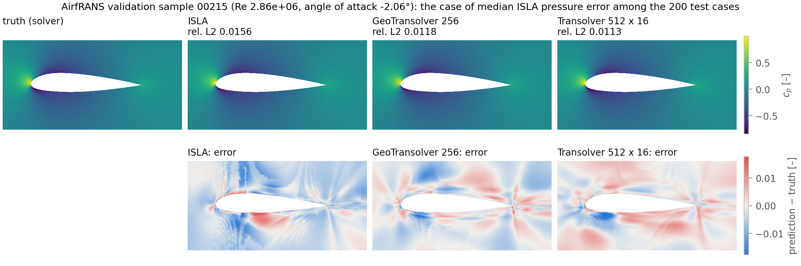
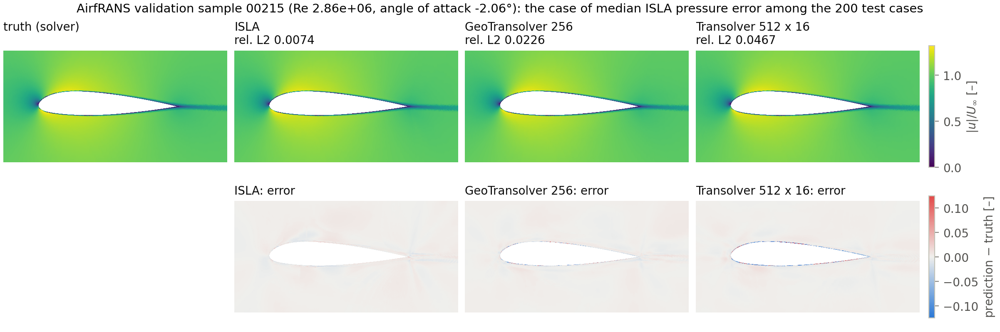

# AirfRANS {#sec-airfrans}

*Before this chapter:* the interior task, in which a model reads the boundary and predicts the field at points in the flow (@sec-interior-task); the scoring protocol (@sec-protocol) and the seed rule (@sec-fair-comparison); the rigid-motion contract (@sec-invariances).

```{python}
#| label: setup-airfrans
#| include: false
import json, re, statistics
from pathlib import Path
import sys; sys.path.insert(0, ".")
from palette import *
import standing as S
from matplotlib.collections import LineCollection
RES = Path("..") / "results"
J = lambda p: json.load(open(RES / p))
mean = statistics.mean
St = S.Standing("airfrans")
FIELDS = list(St.fields.items())          # [(metric key, label)]: pressure, velocity, eddy viscosity
BASE = S.BASELINES
N_TEST = St.cell("ISLA", "pressure_l2")["n_cases"]
N_SEEDS = St.cell("ISLA", "pressure_l2")["n_seeds"]
# the replication pair of the standing's ISLA arm (same configuration and seeds, a second build of the code)
REP = St.raw["replication"]
rep_ratio = {f: REP["native"][f]["mean"] / St.err("ISLA", f) for f, _ in FIELDS}
# the interior points per case in training and scoring, from the scorer of the standing's lanes
CELLS = int(re.search(r"CELLS=(\d+)", (RES / "campaigns_2026-10-14/afu/score.sbatch").read_text()).group(1))
# parameter counts, from the config line of each arm's own scoring record
nparams = lambda run: json.loads(open(RES / f"campaigns_2026-10-14/afu/protocols/{run}/native/metrics.jsonl").readline())["num_parameters"]
PARAMS = {"ISLA": nparams("afu_a2s_isla_seed42"), "GeoTransolver": nparams("afu_r_gt_seed42"), "Transolver": nparams("afu_r_t_seed42")}
COST = J("char/char_lanes_cost_2026-10-04.json")["cost"]["AirfRANS"]
def word(arch, f, p="native"):
    """ISLA against a baseline in the book's words: 'leads GeoTransolver 3.9x', 'trails Transolver (ratio 0.75)', 'is level with ...',
    'is not compared with ...'."""
    v, r = St.verdict(arch, f, p), St.ratio(arch, f, p)
    if v == "leads":
        return f"leads {arch} {S.fmt_ratio(r)}x" if r >= 2 else f"leads {arch} by {S.fmt_pct(r)}"
    if v == "trails":
        return f"trails {arch} (ratio {S.fmt_ratio(r)})"
    return f"{v} {arch}"
seeds_txt = lambda xs: ", ".join(f"{v:.4f}" for v in xs)
FAIR = St.ds.fair_drive   # False: the standing's baselines read the raw inlet velocity, so no ISLA-vs-baseline verdict is drawn
NOTE = St.ds.drive_note.replace("-4.9", "−4.9")
DRIVE = ("" if FAIR else f"In this standing's record GeoTransolver and Transolver read {NOTE} (@tbl-model-inputs).")
def table(label, setting):
    """The headline table; where the baselines' inputs differ from the protocol its caption says the ratios are not compared."""
    t = St.table(label, setting)
    return t if FAIR else t.replace("so a value above one favors ISLA", "and here no ratio is read as a comparison, because the baselines read "
                                      + NOTE)
```

```{python}
#| label: para-airfrans-lede
#| output: asis
isla_posed = max(abs(St.shift("ISLA", f, "posed") - 1) for f, _ in FIELDS)
if FAIR:
    print(f"**On the AirfRANS interior task ISLA {word('GeoTransolver', 'velocity_l2')} and {word('Transolver', 'velocity_l2')} on velocity, "
          f"keeps its error to within {isla_posed * 100:.2f}% when every case is rotated and translated, and when its airfoil is thinned, "
          "its interior error depends strongly on which segments it keeps.** ", end="")
else:
    print(f"**On the AirfRANS interior task ISLA keeps its error to within {isla_posed * 100:.2f}% when every case is rotated and translated, "
          "and when its airfoil is thinned, its interior error depends strongly on which segments it keeps; its native numbers beside "
          "GeoTransolver and Transolver are given and not compared, because those baselines read the inlet velocity as a raw physical "
          "vector.** ", end="")
print("AirfRANS is the book's two-dimensional interior dataset and its one case with a global scalar input, the inlet speed. The chapter shows "
      "the problem, what is measured, the standing of the three reference configurations, three studies that belong to this dataset (the "
      "training-airfoil ladder, the read-only prediction points, the extrapolation splits) and the boundary-sampling study, and ends with what the "
      "dataset does not say. Every ratio is baseline ÷ ISLA.")
```

## The problem: NACA airfoils across Reynolds number and incidence {#sec-dataset-airfrans}

**Each AirfRANS case is a two-dimensional incompressible RANS solution around one NACA airfoil, and the model must recover the whole flow field from the airfoil's outline and the inlet condition.** The source (Bonnet et al., 2022) holds 1,000 solutions with the $k$–$\omega$ SST closure, at Reynolds numbers of 2 to 6 million and angles of attack of −5° to 15°. The boundary is the airfoil polyline: about a thousand line segments, each with an outward normal and its length as the measure weight $w_i$ (the length the segment stands for in every boundary integral). Two global inputs close the problem. The inlet direction is the one *global vector* $\hat g_1$, a unit vector at the angle of attack. The inlet speed $U_\infty$ is the one *global scalar*. The *prediction points* are points of the stored interior mesh; at each one the model predicts pressure, velocity and the eddy viscosity of the turbulence model. @fig-problem-airfrans shows one test case.

```{python}
#| label: fig-problem-airfrans
#| fig-cap: >
#|   The AirfRANS problem, on one test airfoil. Top: what the model is given,
#|   the airfoil polyline with its outward normals (every twelfth drawn), the
#|   inlet direction $\hat g_1$ (black arrow, the global vector) and the inlet
#|   speed (the global scalar); the printed window is where the prediction
#|   points lie. Middle: the pressure coefficient
#|   $C_p = p / \tfrac{1}{2} U_\infty^2$ (kinematic pressure) at the interior
#|   mesh points near the airfoil. Bottom: the speed ratio $|U| / U_\infty$ at
#|   the same points. How to read this: colors are the reference CFD fields,
#|   not predictions; the dots are 70,000 of the case's interior points, and
#|   their density follows the mesh, fine at the wall and in the wake; the
#|   domain extends far beyond this window. Data:
#|   results/problem_figures_2026-09-22/airfrans.npz.
#| code-fold: true
A, Am = load_problem("airfrans")
bp, bc, bn = A["bnd_points"], A["bnd_cells"], A["bnd_normals"]; mid = bp[bc].mean(axis=1)
ip = A["int_points"]
fig, axes = plt.subplots(3, 1, figsize=(8, 7.2), sharex=True, gridspec_kw=dict(hspace=0.22))
ax = axes[0]
ax.add_collection(LineCollection(bp[bc][:, :, :2], colors=BC["free"], linewidths=2.0, zorder=3))
k = slice(None, None, 12); ax.quiver(mid[k, 0], mid[k, 1], bn[k, 0], bn[k, 1], color=MUTED, scale=28, width=0.0025, headwidth=3, zorder=2)
u = A["U_inf_dir"]; ax.annotate("", xy=(-0.45 + 0.3 * u[0], 0.38 + 0.3 * u[1]), xytext=(-0.45, 0.38), arrowprops=dict(arrowstyle="-|>", color=INK, lw=2.0))
ax.text(-0.1, 0.40, f"inlet along $\\hat g_1$ at {Am['aoa_deg']:.2f}° (the global vector); $U_\\infty$ = {Am['U_inf_mag']:.1f} m/s (the global scalar); Re = {Am['Re'] / 1e6:.1f} million", ha="left", va="center", fontsize=8.5, color=INK2)
ib = A["interior_bbox"]
map_axes(ax); ax.set_xlim(-0.5, 1.5); ax.set_ylim(-0.55, 0.55); ax.set_ylabel("y / chord [–]")
ax.set_title(f"the boundary: {Am['n_boundary_cells']:,} line segments (position, normal, length), a no-slip wall; prediction points fill {ib[0,0]:.0f} < x < {ib[1,0]:.0f}, {ib[0,1]:.0f} < y < {ib[1,1]:.0f} chords", fontsize=9.2)
cb0 = fig.colorbar(mpl.cm.ScalarMappable(cmap=SEQUENTIAL), ax=ax, fraction=0.035, pad=0.02); cb0.ax.set_visible(False)   # aligns the panels
ax = axes[1]
sc = field_scatter(ax, ip[:, :2], A["int_cp"], s=2.5, signed=True, vmin=-1.0, vmax=1.0); map_axes(ax); ax.set_ylim(-0.55, 0.55)
ax.add_collection(LineCollection(bp[bc][:, :, :2], colors=INK, linewidths=0.8, zorder=3)); ax.set_ylabel("y / chord [–]")
ax.set_title("pressure coefficient $C_p$ at the interior points (target)", fontsize=9.5)
small_colorbar(fig, sc, ax, "$C_p$ [–]", extend="both")
ax = axes[2]
sc = field_scatter(ax, ip[:, :2], A["int_umag"], s=2.5, vmin=0, vmax=1.3); map_axes(ax); ax.set_ylim(-0.55, 0.55)
ax.add_collection(LineCollection(bp[bc][:, :, :2], colors=WHITE, linewidths=0.8, zorder=3)); ax.set_ylabel("y / chord [–]"); ax.set_xlabel("x / chord [–]")
ax.set_title("speed ratio $|U| / U_\\infty$ at the interior points (target)", fontsize=9.5)
small_colorbar(fig, sc, ax, "$|U| / U_\\infty$ [–]", extend="max")
plt.show()
```

```{python}
#| label: para-airfrans-samples
#| output: asis
As_, Asm = load_samples("airfrans")
cs = Asm["cases"]; tr = Asm["test_ranges"]; Us = [c["U_inf_mag"] for c in cs]
print(f"**Across the set, the airfoil, the inlet direction and the inlet speed all change together.** @fig-airfrans-samples shows six of the "
      f"{Asm['n_test']} test cases: the four corners of the (Reynolds number, angle of attack) rectangle, which over the test set runs from "
      f"Re = {tr['Re'][0] / 1e6:.1f} to {tr['Re'][1] / 1e6:.1f} million and from {tr['aoa_deg'][0]:.1f}° to {tr['aoa_deg'][1]:.1f}°, and the two "
      f"cases nearest its center, one four-digit and one five-digit NACA section. The inlet speed runs from {min(Us):.0f} to {max(Us):.0f} m/s "
      "across the six, and every case has its own mesh.")
```

```{python}
#| label: fig-airfrans-samples
#| fig-cap: >
#|   Six AirfRANS test cases at the corners and the center of the (Reynolds
#|   number, angle of attack) range: the speed ratio $|U| / U_\infty$ at the
#|   interior mesh points near the airfoil (35,000 of each case's points), the
#|   airfoil in white and the inlet direction $\hat g_1$ as a black arrow; the
#|   Reynolds number, the angle, the inlet speed and the NACA family are printed
#|   per panel, on one color scale for all six. How to read this: the top and
#|   bottom rows are the corners, low Reynolds number on the left and high on
#|   the right, low angle on top and high at the bottom; the middle row holds
#|   the two cases nearest the center; as the angle rises the
#|   stagnation point moves under the nose and the wake thickens and tilts,
#|   which the model must learn from the direction vector alone; colors are the
#|   reference CFD field, not predictions. Data:
#|   results/sample_figures_2026-10-02/airfrans.npz.
#| code-fold: true
io = As_["int_offsets"]; po = As_["bnd_point_offsets"]; co = As_["bnd_cell_offsets"]
fig, axes = plt.subplots(3, 2, figsize=(8, 8.8), sharex=True, sharey=True, gridspec_kw=dict(hspace=0.3, wspace=0.05))
for i, c in enumerate(cs):
    ax = axes[i // 2, i % 2]
    ip = part(As_["int_points"], io, i); um = part(As_["int_umag"], io, i)
    bp = part(As_["bnd_points"], po, i); bc = part(As_["bnd_cells"], co, i)
    sc = field_scatter(ax, ip[:, :2], um, s=2.2, vmin=0, vmax=1.3); map_axes(ax)
    ax.add_collection(LineCollection(bp[bc][:, :, :2], colors=WHITE, linewidths=0.9, zorder=3))
    u = As_["U_inf_dir"][i]; ax.annotate("", xy=(-0.4 + 0.25 * u[0], 0.4 + 0.25 * u[1]), xytext=(-0.4, 0.4), arrowprops=dict(arrowstyle="-|>", color=INK, lw=1.8))
    ax.text(-0.1, 0.42, f"$\\hat g_1$ at {c['aoa_deg']:.1f}°", ha="left", va="center", fontsize=7.8, color=INK, path_effects=halo())
    ax.set_xlim(-0.5, 1.6); ax.set_ylim(-0.6, 0.6)
    ax.set_title(f"Re = {c['Re'] / 1e6:.1f} million, $\\alpha$ = {c['aoa_deg']:.1f}°\n$U_\\infty$ = {c['U_inf_mag']:.0f} m/s, NACA {'five' if c['naca_five_digit'] else 'four'}-digit section", fontsize=8.3)
    if i % 2 == 0: ax.set_ylabel("y / chord [–]")
    if i // 2 == 2: ax.set_xlabel("x / chord [–]")
cb = fig.colorbar(sc, ax=axes, fraction=0.02, pad=0.01, extend="max"); cb.set_label("$|U| / U_\\infty$ [–]"); cb.outline.set_visible(False)
plt.show()
```

The geometry family is narrow: smooth airfoils of one parameterization, in a planar flow. AirfRANS therefore tests how a model reads its global inputs more than how it reads geometry; AeroZoo (@sec-aerozoo) is the dataset for geometry.

### Files, conversion and normalization {#sec-data-airfrans}

**The release is converted once from VTK into the recipe's mesh format, and the targets are made dimensionless by the inlet condition.** Each case directory of the release, `airFoil2D_SST_<speed>_<aoa>_<NACA parameters>`, holds an `_internal.vtu` interior of about 177,000 cells with velocity `U`, pressure `p`, eddy viscosity `nut` and the signed distance `implicit_distance` at the points, an `_aerofoil.vtp` polyline and a `_freestream.vtp` far boundary. The chord is 1 m and the kinematic viscosity 1.56e-5 m²/s.

- **Conversion** (`airfrans_convert.py`, @tbl-data-files). The interior becomes a point cloud with `velocity`, `pressure`, `nut`, `sdf` (the stored signed distance, positive outside the airfoil) and `sdf_normals`, the in-plane unit vector from the nearest airfoil point. The boundary `airfoil` is line cells with in-plane outward normals and the segment lengths as `quadrature_measure`. `global_data` holds `U_inf` (parsed from the case name and checked against the far boundary), `U_inf_dir`, `U_inf_mag`, `aoa_deg`, `Re` and the NACA parameters.
- **Normalization** (`airfrans_uvolume_2d.yaml`). Pressure is kinematic ($\rho_\infty = 1$, $p_\infty = 0$) and divided by $\tfrac{1}{2} U_\infty^2$; velocity is divided by $U_\infty$; `nut` keeps its units and is standardized (mean 7.9e-4 m²/s, standard deviation 2.4e-3 m²/s, from the converter's per-case statistics).
- **The interior draw.** The reader takes each case whole and the first transform keeps a uniform random subset of the interior points (`SubsampleMesh`). The stored points run through space in the solver's order, so a uniform draw is needed to cover the domain.
- **Splits** (the release's manifest, unchanged). `full`: 800 train / 200 test; `scarce`: 200 train; `reynolds`: 504 / 496, an extrapolation in Reynolds number; `aoa`: 804 / 196, an extrapolation in angle of attack. The training-airfoil ladder uses nested subsets of 50 to 400 airfoils inside `full` (@sec-airfrans-ladder).

## What is measured {#sec-airfrans-measured}

```{python}
#| label: para-airfrans-measured
#| output: asis
print(f"**The interior task on the `full` split: 800 training airfoils, {N_TEST} test airfoils, {CELLS:,} interior points per case, 500 epochs, "
      f"{['no', 'one', 'two', 'three'][N_SEEDS]} seeds, float32 scoring.** The {CELLS:,} points are about half of each case's stored interior points, drawn uniformly at random "
      "in training and in scoring. The metric is the per-case relative L2 per field averaged over the test cases (@sec-metrics). Eddy viscosity "
      "is standardized before scoring, so its ratios order the models but are not physical percentages. The three architectures run at their "
      "reference configurations, the same on every dataset of the book (@sec-selection, @tbl-architectures):")
print()
print(f"- **ISLA**: width 512, 12 layers, 512 slices, learning rate 3.75e-4, {PARAMS['ISLA'] / 1e6:.1f}M parameters; the slice sublayer reads "
      "the normalized token state (@sec-isla-layer).")
print(f"- **GeoTransolver**: width 256, learning rate 1e-3, {PARAMS['GeoTransolver'] / 1e6:.1f}M parameters.")
print(f"- **Transolver**: width 512, 16 layers, learning rate 1e-3, {PARAMS['Transolver'] / 1e6:.1f}M parameters.")
print()
print("No model trains with rotation or translation augmentation. **The three do not receive the same inputs** (@tbl-airfrans-inputs, "
      "@tbl-model-inputs): GeoTransolver and Transolver never see the airfoil, only a signed distance to it stored at every point, and they "
      "read the inlet velocity as the physical vector in m/s, where ISLA reads its unit direction and the speed as a separate scalar.")
```

| | boundary | global inputs | at each prediction point |
|---|---|---|---|
| ISLA | the airfoil polyline: each segment's position, normal and length | $\hat g_1$, the unit inlet direction (rank 1), and the inlet speed $U_\infty$ in m/s (rank 0) | position, entering only through relational invariants; the stored `sdf` (rank 0) and `sdf_normals` (rank 1); the distance and direction to the nearest boundary token, computed inside the model |
| GeoTransolver | none | the inlet velocity $U_\infty \hat g_1$ as the physical vector in m/s, read by the context projector | coordinates; the stored `sdf` and `sdf_normals` |
| Transolver | none | the same physical vector, concatenated to every point's features | coordinates; the stored `sdf` and `sdf_normals` |

: What each architecture receives on the AirfRANS interior task. How to read this: only ISLA reads the airfoil itself; the stored signed distance is exact (computed by the converter from the full airfoil), while ISLA's built-in nearest-token distance and direction depend on which boundary segments the model is given, the one input of the interior task that changes with the boundary sample (@sec-airfrans-boundary-law); the global column carries the same information for all three, but the baselines receive it as one vector whose magnitude runs from 31 to 94 m/s and whose angle runs from −4.9° to 14.9° across the cases. Data: conf/model/isla_volume_airfrans.yaml of the recipe, the two baselines' recipe configurations (@sec-baselines) and results/drive_audit_2026-10-18/REPORT.md. {#tbl-airfrans-inputs}

```{python}
#| label: para-airfrans-scorings
#| output: asis
epoch_ratio = COST["ISLA"]["epoch_seconds"] / mean(COST[a]["epoch_seconds"] for a in BASE)
print("**Each checkpoint is scored twice on the same test cases**: on the native mesh, and with every case rotated in its plane and "
      "translated by one RMS point radius, the inlet direction rotated with it (@sec-pose). The uniform-point-cloud scoring of the surface "
      "datasets is not shown: the airfoil has fewer segments than the scoring budget and the interior points carry no cells, so at that budget "
      "it returns the native mesh. The boundary draw is instead measured at a reduced budget (@sec-airfrans-boundary-law).")
print()
print("**Cost.** One training epoch on four GB300 ranks in bfloat16 (peak device memory over the ranks): "
      + "; ".join(f"{a} {v['peak_gib']:.0f} GiB and {v['epoch_seconds']:.0f} s" for a, v in COST.items())
      + f". ISLA's epoch is {epoch_ratio:.1f} times the baselines' mean on this planar task. Instrument (memory and time): ISLA at 512 wide, "
      "512 slices, 3.75e-4, raw slice reads (@sec-study-configurations); the normalized slice reads change no parameter and no tensor shape. "
      "Data: results/char/char_lanes_cost_2026-10-04.json.")
```

## The standing {#sec-interior-airfrans}

```{python}
#| label: para-airfrans-standing-lede
#| output: asis
if FAIR:
    print(f"**ISLA {word('GeoTransolver', 'velocity_l2')} and {word('Transolver', 'velocity_l2')} on interior velocity; on pressure it "
          f"{word('GeoTransolver', 'pressure_l2')} and {word('Transolver', 'pressure_l2')}; on eddy viscosity it {word('GeoTransolver', 'nut_l2')} "
          f"and {word('Transolver', 'nut_l2')}.** The words follow the seed rule: ISLA leads or trails only when every seed of one model lies beyond "
          "every seed of the other and the seed means differ by at least 3%. @tbl-airfrans-protocols holds the numbers.")
else:
    print("**The standing's native numbers are given and not compared, because its baselines read the inlet velocity as a raw physical "
          f"vector.** {DRIVE} On AirfRANS the inlet changes in speed and in angle from case to case, so the vector the baselines read "
          "changes threefold in length as well as turning with the angle of attack, where ISLA's unit direction only turns. "
          "@tbl-airfrans-protocols holds each architecture's errors. They are a record of these trained models, "
          "not a comparison of the architectures: no verdict is drawn from them in this book. The protocol column is read below for each "
          "architecture against its own native error.")
```

```{python}
#| label: out-tbl-airfrans-protocols
#| output: asis
print(table("tbl-airfrans-protocols", f"The AirfRANS interior task, `full` split, {N_TEST} test airfoils"))
```

<!-- SLOT: unit-direction baseline pair (registry swap when scored) -->

```{python}
#| label: para-airfrans-replication
#| output: asis
print("::: {.callout-note collapse=\"true\" title=\"Optional: a second pair of ISLA checkpoints\"}")
print(f"A second pair of ISLA checkpoints, an independent second training of the same configuration and seeds, scores "
      + " / ".join(f"{REP['native'][f]['mean']:.4f}" for f, _ in FIELDS) + " on " + " / ".join(l for _, l in FIELDS)
      + ", that is " + " / ".join(f"{rep_ratio[f]:.3f}" for f, _ in FIELDS) + " times the standing's ISLA checkpoints. The replication moves "
      f"pressure and velocity by under {max(abs(rep_ratio[f] - 1) for f in ('pressure_l2', 'velocity_l2')) * 100:.1f}% and eddy viscosity by "
      f"{abs(rep_ratio['nut_l2'] - 1) * 100:.1f}%, inside the standing's own ISLA seed spread on eddy viscosity "
      f"({seeds_txt(St.seeds('ISLA', 'nut_l2'))}). Data: {St.source} (`replication`).")
print(":::")
```

```{python}
#| label: para-airfrans-reading
#| output: asis
b_shift = [St.shift(a, f, "posed") for a in BASE for f, _ in FIELDS]
b_posed_err = [St.err(a, f, "posed") for a in BASE for f, _ in FIELDS]
if FAIR:
    V = S.Standing("drivaerml_volume")
    print(f"**Against the cars.** On the DrivAerML Volume task GeoTransolver ÷ ISLA is {V.ratio('GeoTransolver', 'velocity_l2'):.2f} on "
          f"velocity and {V.ratio('GeoTransolver', 'pressure_l2'):.2f} on pressure (@sec-interior-results); here it is "
          f"{S.fmt_ratio(St.ratio('GeoTransolver', 'velocity_l2'))} and {St.ratio('GeoTransolver', 'pressure_l2'):.2f}. The two datasets differ "
          "in what pressure is (gauge pressure on a three-dimensional body against a pressure coefficient in planar incompressible flow) and "
          "in what the boundary is (200,000 sampled cells of a car against a polyline of about a thousand segments).")
    print()
print(f"**Under rotation and translation ISLA's error is its native error, and the baselines' errors pass the score of predicting zero.** "
      f"ISLA's largest shift on any field is {max(abs(St.shift('ISLA', f, 'posed') - 1) for f, _ in FIELDS) * 100:.2f}% of its native error. "
      f"GeoTransolver's and Transolver's posed errors are {S.fmt_ratio(min(b_shift))} to {S.fmt_ratio(max(b_shift))} times their own native "
      f"errors, every one of the six at or above {min(b_posed_err):.2f}, worse than predicting zero everywhere. They read raw "
      "coordinates and never trained on a rotated airfoil, so a rotated airfoil is outside their training distribution even though the "
      "inlet velocity rotates with it.")
```

```{python}
#| label: out-fig-airfrans-prediction
#| output: asis
#| column: page
RD = J("renderings_2026-10-18/arrays/render_2d_airfrans.json")["airfrans"]
PE = RD["per_sample_rel_l2"]

print("::: {#fig-airfrans-prediction layout-nrow=2}\n")
print("\n")
print("\n")
print(f"The three reference configurations on one held-out AirfRANS airfoil (Reynolds number {RD['Re'] / 1e6:.2f} million, angle of attack "
      f"{RD['aoa_deg']:.1f}°), the case of median ISLA pressure error among the {N_TEST} test airfoils, seed 42. Top row of each panel: the "
      "solver's field and each model's prediction on one color scale; bottom row: prediction minus solver, on one symmetric scale. "
      f"Relative L2 on this case: {case_errors(PE)}. How to read this: one case, not a standing; the "
      "baselines read the inlet velocity as the physical vector, so the panels show what each trained model does and are not a "
      "comparison. ISLA's error map is cut into straight-edged patches around the airfoil, the shape of a quantity that is piecewise "
      "constant over the points that share a nearest boundary token (@sec-isla-interior); the book does not measure that link further. "
      "The 100,000 points are drawn once for this figure, so ISLA's pressure error differs slightly from the scored record's. Data: "
      "results/renderings_2026-10-18/arrays/render_2d_airfrans.json and airfrans_00215.npz.\n")
print(":::")
```

## Studies on this dataset {#sec-airfrans-ladders}

**Three studies on this dataset use smaller ISLA configurations than the reference one; they are read for slopes and mechanisms, never as standings.** Each caption names its instrument in the tag of @sec-study-configurations. Their baseline is *GeoTransolver-volume*, the GeoTransolver of the DrivAerML Volume task with its ball-query local features on (@sec-baselines), at width 256 and learning rate 1e-3, where the standing uses the reference GeoTransolver. Like the standing's baselines it reads the inlet velocity as the physical vector (@tbl-model-inputs), so a comparison with it carries the same input difference and is a statement about these two configurations. The three studies also read the interior points as contiguous blocks of the stored rows, a spatially coherent window of the domain rather than a uniform sample, in training and in scoring alike. The comparisons inside each study are like for like; their absolute errors are not comparable with @tbl-airfrans-protocols. The fourth study, the boundary draw, is measured on the standing's own checkpoints.

### The training-airfoil ladder {#sec-airfrans-ladder}

```{python}
#| label: para-airfrans-ladder
#| output: asis
AFS = J("airfrans_scale_2026-09-22.json"); AFF = AFS["fits"]; ORD = AFS["bars"]["ordering"]["pressure_l2"]["per_rung"]
a_p, a_v = AFF["isla|pressure_l2"]["fit"]["alpha"], AFF["isla|velocity_l2"]["fit"]["alpha"]
gt_loc = [v for k, v in AFF["gt|pressure_l2"]["local_alpha"].items() if int(k.split("-")[0]) >= 100]
print(f"**On AirfRANS no error floor is in reach at 800 airfoils: ISLA's error falls as a clean power law in the number of "
      f"training airfoils.** The ladder trains ISLA and GeoTransolver-volume on nested subsets of "
      f"50, 100, 200, 400 and 800 airfoils, two seeds each "
      f"(@fig-scaling-airfrans). ISLA's error falls as a clean power law $\\varepsilon \\propto n^{{-b}}$ in the number of training airfoils "
      f"$n$, with the data exponent $b$ = {a_p:.2f} on pressure and {a_v:.2f} on velocity. GeoTransolver-volume's local pressure exponent is "
      f"{min(gt_loc):.2f} to {max(gt_loc):.2f} from 100 airfoils up, and its 50-airfoil error sits above its own trend, so no fit is accepted for it; "
      "it reads the inlet velocity as the physical vector, so its curve is drawn for reference and the two are not compared. One consequence "
      "follows for the compute-allocation rule of @sec-compute-allocation, which splits a fixed training budget between more cases and more "
      "parameters by comparing the data exponent with the parameter exponent. This ladder trains one width and so measures only the data "
      "exponent; what it gives that rule is that no floor limits what more training cases buy ISLA across the range measured here.")
```

```{python}
#| label: fig-scaling-airfrans
#| fig-cap: >
#|   Interior error against training airfoils on the AirfRANS interior task:
#|   pressure (left), velocity (middle) and eddy viscosity (right, a
#|   standardized field), two-seed means with the seeds as short bars, float32
#|   on the 200 test airfoils, 500 epochs at 100,000 interior points. ISLA in
#|   blue squares, GeoTransolver-volume (learning rate 1e-3, reading the inlet
#|   velocity as the physical vector, not compared) in red circles.
#|   Dotted curves are fits of $\varepsilon = \varepsilon_\infty + a
#|   n^{-b}$, drawn only where the fit's RMS relative residual is below 3%;
#|   other series carry their local exponents from 100 airfoils up. Instrument:
#|   ISLA at 192 wide, 256 slices, 1e-3, raw slice reads
#|   (@sec-study-configurations); interior points read as contiguous blocks of
#|   the stored rows. How to read this: the slope of a run of points is its
#|   data exponent; the levels are those of the instrument, not the standing,
#|   and there is no parameter axis; both axes are logarithmic. Data:
#|   results/airfrans_scale_2026-09-22.json.
#| fig-alt: "Three log-log panels of interior error against training airfoils from 50 to 800: ISLA in blue squares with dotted fitted lines on pressure and velocity, GeoTransolver-volume in red circles as points only, each series labeled at its right end with its exponent b."
#| code-fold: true
AC = AFS["configurations"]
fig, axes = plt.subplots(1, 3, figsize=(11.0, 3.9), sharex=True)
nn = np.geomspace(45, 900, 100)
AC_last = {f: [max(((c["n"], c[f]["mean"]) for c in AC.values() if c["arm"] == m and c["status"] == "complete" and f in c))
               for m in ("isla", "gt")] for f in ("pressure_l2", "velocity_l2", "nut_l2")}
for ax, (f, lab) in zip(axes, (("pressure_l2", "interior pressure"), ("velocity_l2", "interior velocity"), ("nut_l2", "interior eddy viscosity"))):
    for m, key in (("isla", "isla_ref"), ("gt", "gt")):
        kw = series_kwargs(key)
        rows = sorted([(c["n"], c[f]["mean"], c[f]["seeds"]) for c in AC.values() if c["arm"] == m and c["status"] == "complete" and f in c])
        ax.plot([r[0] for r in rows], [r[1] for r in rows], marker=kw["marker"], color=kw["color"], ls="none", ms=6)
        for r in rows:
            ax.plot([r[0]] * len(r[2]), r[2], ls="none", marker="_", color=kw["color"], ms=7, mew=1.1)
        F = AFF[f"{m}|{f}"]["fit"]; accepted = F["rms_rel_residual"] < 0.03
        loc = AFF[f"{m}|{f}"]["local_alpha"]; tail = [v for k, v in loc.items() if int(k.split("-")[0]) >= 100]
        if accepted:
            ax.plot(nn, F["eps_inf"] + F["a"] * nn ** (-F["alpha"]), color=kw["color"], ls=":", lw=1.1, zorder=0)
            lab_a = f"b = {F['alpha']:.2f} (fit)"
        else:
            lab_a = f"local b {min(tail):.2f} to {max(tail):.2f}"
        name = "ISLA" if m == "isla" else "GeoTransolver-\nvolume"
        up = rows[-1][1] >= max(r[1] for r in AC_last[f])   # the upper series is labeled above its last point, the lower below
        ax.annotate(f"{name}\n{lab_a}", xy=(rows[-1][0], rows[-1][1]), xytext=(9, 5 if up else -5), textcoords="offset points",
                    fontsize=8.4, color=kw["color"], va="bottom" if up else "top", ha="left", path_effects=halo())
    ax.set_xscale("log"); ax.set_yscale("log"); ax.set_xticks([50, 100, 200, 400, 800]); ax.set_xticklabels(["50", "100", "200", "400", "800"])
    ax.xaxis.set_minor_formatter(mpl.ticker.NullFormatter()); ax.yaxis.set_minor_formatter(mpl.ticker.NullFormatter())
    ax.set_yticks([0.02, 0.03, 0.05, 0.1, 0.2]); ax.set_yticklabels(["0.02", "0.03", "0.05", "0.10", "0.20"]); ax.set_xlim(42, 3600)
    ax.set_xlabel("training airfoils [count]"); ax.set_ylabel(f"{lab} relative L2 error [–]")
plt.tight_layout(); plt.show()
```

### Read-only prediction points {#sec-airfrans-read-only}

```{python}
#| label: para-airfrans-read-only-data
#| include: false
# The read-only controls are reported in research/dtt/REPORT.md: the "E5 interim" table (interacting, passive without a read, dense
# global read) and the "Pose-free parity on AirfRANS" table (ISLA-DTT, the forest in the boundary's own frame). Each row: seed 42,
# seed 43, seed mean, each "pressure / velocity / eddy viscosity".
REPORT = (Path("..") / "research" / "dtt" / "REPORT.md").read_text().splitlines()
def report_row(section, prefix):
    start = next(i for i, l in enumerate(REPORT) if l.startswith(section))
    line = next(l for l in REPORT[start:] if l.startswith(f"| {prefix} |"))
    cells = [c.strip() for c in line.strip().strip("|").split("|")]
    return [[float(x) for x in c.split(" / ")] for c in cells[1:4]]
RO = {"ISLA, interacting prediction points": report_row("### E5 interim", "I, interacting"),
      "read-only prediction points, no boundary read": report_row("### E5 interim", "P, read-only, no read"),
      "read-only prediction points, dense global read": report_row("### E5 interim", "G, dense exact read"),
      "ISLA-DTT (forest read at θ = 1)": report_row("### Pose-free parity on AirfRANS", "forest, own frame (`code_dtt16`)")}
RO_I = RO["ISLA, interacting prediction points"][2]
ro_ratio = lambda k: [m / i for m, i in zip(RO[k][2], RO_I)]
RO_SEEDS = lambda k, j: [RO[k][0][j], RO[k][1][j]]
def ro_word(k, j):
    """One read-only row against the interacting row on field j, by the book's seed rule (standing.Standing.verdict)."""
    a, i = RO_SEEDS(k, j), RO_SEEDS("ISLA, interacting prediction points", j)
    if abs(ro_ratio(k)[j] - 1) < S.TIE_BAND:
        return "level with ISLA"
    if min(a) > max(i):
        return "behind ISLA"
    if max(a) < min(i):
        return "ahead of ISLA"
    return "level with ISLA"
```

```{python}
#| label: para-airfrans-read-only
#| output: asis
K_DTT, K_NOR, K_DENSE = "ISLA-DTT (forest read at θ = 1)", "read-only prediction points, no boundary read", "read-only prediction points, dense global read"
dtt = ro_ratio(K_DTT); nor = ro_ratio(K_NOR)
dtt_dense = [a / b for a, b in zip(RO[K_DTT][2], RO[K_DENSE][2])]
gain = [1 - d / n_ for d, n_ in zip(RO[K_DENSE][2], RO[K_NOR][2])]   # the error the dense read removes from the no-read row
names3 = ("pressure", "velocity", "eddy viscosity")
print(f"**On the airfoil, read-only prediction points with a global read of the boundary are more accurate than interacting ones on "
      f"pressure and velocity: ISLA-DTT ÷ ISLA is {' / '.join(f'{v:.2f}' for v in dtt)} on pressure / velocity / eddy viscosity "
      "within one instrument.** In ISLA the prediction points are *interacting*: they carry routing mass, write into the slices and so "
      "influence one another. In ISLA-DTT they are *read-only*: they read the boundary's slices at every layer, never write, and also read "
      "every boundary segment through a learned kernel evaluated with a Barnes–Hut cluster forest at opening angle θ = 1, built, to group "
      "segments for speed, in a canonical frame that the boundary carries (@sec-arch-passive-decoder, @sec-arch-tree-read). A prediction then depends on its own point "
      "and the boundary alone. @tbl-airfrans-read-only separates the two changes. Read-only points without any boundary read are "
      + ", ".join(f"{ro_word(K_NOR, j)} on {names3[j]}" for j in range(3))
      + f" by the seed rule ({' / '.join(f'{v:.2f}' for v in nor)}), where on the DrivAerML Volume task they trail it "
      f"(@sec-interior-read-only). The global read removes a further {min(gain[:2]) * 100:.0f}% to {max(gain[:2]) * 100:.0f}% of their "
      f"pressure and velocity error and {gain[2] * 100:.0f}% on eddy viscosity. The forest keeps the gain on pressure and velocity: "
      f"ISLA-DTT ÷ the dense pairwise read is {dtt_dense[0]:.2f} / {dtt_dense[1]:.2f} there. On eddy viscosity it keeps less of it: "
      f"ISLA-DTT ÷ the dense read is {dtt_dense[2]:.2f}, and the forest's {RO[K_DTT][2][2]:.4f} lies at the upper end of the dense read's seed range ({min(RO_SEEDS(K_DENSE, 2)):.4f} to "
      f"{max(RO_SEEDS(K_DENSE, 2)):.4f}), near the {RO[K_NOR][2][2]:.4f} of read-only points without a read.")
```

```{python}
#| label: out-tbl-airfrans-read-only
#| output: asis
out = "| configuration | pressure (seeds) | velocity (seeds) | eddy viscosity (seeds) | ÷ ISLA: p / v / nut |\n|---|---|---|---|---|\n"
for k, (s42, s43, m) in RO.items():
    cells = [f"{m[j]:.4f} ({s42[j]:.4f}, {s43[j]:.4f})" for j in range(3)]
    out += f"| {k} | " + " | ".join(cells) + " | " + ("1" if k.startswith("ISLA,") else " / ".join(f"{v:.2f}" for v in ro_ratio(k))) + " |\n"
print(out)
print(": Read-only prediction points on the AirfRANS interior task: relative L2 of interior pressure, velocity and eddy viscosity on the 200 "
      "test airfoils of the `full` split, float32, seed mean with seeds 42 and 43 in brackets; 800 training airfoils, 500 epochs, 100,000 "
      "interior points, the whole airfoil polyline as the boundary. The four rows differ only in the prediction points' role and the boundary "
      "read; the dense read evaluates the global read pair by pair. Instrument: ISLA at 384 wide, 256 slices, 5e-4, raw slice reads "
      "(@sec-study-configurations); interior points read as contiguous blocks of the stored rows. How to read this: ÷ ISLA below one means more "
      "accurate than the interacting row; the rows are a within-instrument control, not the standing (@tbl-airfrans-protocols); rotated and "
      "translated, ISLA-DTT keeps its native error. Data: research/dtt/REPORT.md (the AirfRANS "
      "read-only control and the pose-free parity table). {#tbl-airfrans-read-only}")
```

### Outside the training range: the extrapolation splits {#sec-interior-extrapolation}

```{python}
#| label: para-airfrans-extrap
#| output: asis
AFX = J("airfrans_extrap_2026-09-22.json")["splits"]
print("**Outside the training range ISLA's interior error grows by a factor of "
      f"{min(AFX[sp]['arms']['isla_cosine_1e-3'][f]['growth_mean'] for sp in ('reynolds', 'aoa') for f, _ in FIELDS):.1f} to "
      f"{max(AFX[sp]['arms']['isla_cosine_1e-3'][f]['growth_mean'] for sp in ('reynolds', 'aoa') for f, _ in FIELDS):.1f} over its "
      "own `full`-split error.** AirfRANS ships two extrapolation splits: `reynolds` trains on 504 airfoils inside a band of "
      "Reynolds numbers and tests on 496 outside it, and `aoa` trains on 804 inside a band of angles and tests on 196 outside it. The readout "
      "that separates extrapolation from a smaller training set is the *growth factor*: an architecture's test error on the split divided by "
      "its own error on the `full` split (@tbl-interior-airfrans-extrap). GeoTransolver-volume's growth factors are given beside ISLA's and "
      "are not compared with them: it reads the inlet velocity as the physical vector, and its magnitude and angle are exactly what leaves "
      "the training range on these splits, so a difference in growth would measure the input as much as the architecture "
      "(@sec-oq-unit-direction).")
```

```{python}
#| label: out-tbl-interior-airfrans-extrap
#| output: asis
names = {"reynolds": "Reynolds number", "aoa": "angle of attack"}
out = ("| split | field | ISLA error (growth) | GeoTransolver-volume error (growth) |\n|---|---|--:|--:|\n")
for sp in ("reynolds", "aoa"):
    X = AFX[sp]
    for f, lab in FIELDS:
        gi, gg = X["arms"]["isla_cosine_1e-3"][f], X["arms"]["gt_volume_1e-3"][f]
        out += f"| {names[sp]} | {lab} | {gi['mean']:.4f} ({gi['growth_mean']:.2f}) | {gg['mean']:.4f} ({gg['growth_mean']:.2f}) |\n"
print(out)
print(": The AirfRANS extrapolation splits: relative L2 on each split's test cases, float32, two seeds, 100,000 interior points, 500 epochs. "
      "Growth = the split's test error ÷ the same architecture's `full`-split test error. GeoTransolver-volume reads the inlet velocity as "
      "the physical vector, so its column is not compared with ISLA's. "
      "Instrument: ISLA at 192 wide, 256 slices, 1e-3, raw slice reads (@sec-study-configurations); interior points read as contiguous blocks "
      "of the stored rows. How to read this: the Reynolds split trains on 504 airfoils against the `full` split's 800, so part of each growth "
      "factor is data size. Data: results/airfrans_extrap_2026-09-22.json. {#tbl-interior-airfrans-extrap}")
```

### The boundary draw at a reduced budget {#sec-airfrans-boundary-law}

```{python}
#| label: setup-airfrans-area2
#| include: false
B2 = J("char/airfrans_area2_a2.json")
B2R = {a: sorted([r for r in B2["runs"].values() if r["arm"] == a], key=lambda r: r["seed"]) for a in ("ISLA", "exact-geometry variant")}
per_seed = lambda arm, f, key: [r["fields"][f][key] for r in B2R[arm]]
law = lambda arm, f: per_seed(arm, f, "r"); floor = lambda arm, f: per_seed(arm, f, "d"); count = lambda arm, f: per_seed(arm, f, "count_effect")
SEG = B2["budget_segments"]
```

```{python}
#| label: para-airfrans-area2-lede
#| output: asis
pv = [v for f in ("pressure_l2", "velocity_l2") for v in law("ISLA", f)]
cnt = [v for f, _ in FIELDS for v in count("ISLA", f)]
print(f"**ISLA's interior error depends on which airfoil segments it is given: with the airfoil thinned "
      f"to an expected {SEG} segments, a draw in proportion to segment length makes ISLA's pressure and velocity errors {min(pv):.1f} to "
      f"{max(pv):.1f} times those of a uniform draw of the same count.** What changes with the draw is the one discretization-dependent input "
      "of the interior task. Each prediction point takes a distance and a direction from its nearest boundary token (@tbl-airfrans-inputs), and that direction "
      "serves as the point's normal in every relational invariant (@sec-isla-relational). A nearest-token distance overestimates the true wall "
      "distance by up to half the local token spacing, and the spacing is set by the draw. @fig-airfrans-draw-spacing shows what the two "
      "draws do to the spacing on a real AirfRANS airfoil. A variant that takes the distance and direction from the full-resolution airfoil "
      "instead reverses the law effect on the same draws: for it the length-proportional draw is the better one (@sec-airfrans-limits).")
```

```{python}
#| label: fig-airfrans-draw-spacing
#| fig-cap: >
#|   Two draws of an expected 400 of one test airfoil's segments. Top: the
#|   segments of the upper surface that the mesh holds and that one uniform
#|   draw and one length-proportional draw keep, each a tick at its distance
#|   from the leading edge. Bottom: the expected token spacing along the upper
#|   surface, each segment's length divided by its inclusion probability. The mesher refines the leading and trailing edges; a uniform
#|   draw keeps that refinement and coarsens every region by the same factor,
#|   while a length-proportional draw keeps the long mid-chord segments and
#|   strips the short ones, so its spacing is the same everywhere. Both draws
#|   divide each kept segment's length by its inclusion probability, so every
#|   boundary integral stays unbiased. How to read this: a prediction point's
#|   nearest-token distance errs by up to half the spacing, so near the
#|   leading edge the length-proportional draw hands each point a much coarser
#|   geometry; the figure shows the inputs, not a trained model's errors.
#|   Data: results/problem_figures_2026-09-22/airfrans.npz (the airfoil of
#|   @fig-problem-airfrans).
#| code-fold: true
A, Am = load_problem("airfrans")
bp, bc, bn = A["bnd_points"][:, :2], A["bnd_cells"], A["bnd_normals"][:, :2]
mid = bp[bc].mean(axis=1); w = np.linalg.norm(bp[bc[:, 1]] - bp[bc[:, 0]], axis=1)
def inclusion(weights, n):
    """Inclusion probabilities proportional to the weights with expected count n, each capped at one (water-filling)."""
    pi = np.zeros_like(weights, dtype=float); free = np.ones(len(weights), bool)
    for _ in range(50):
        pi[free] = (n - (~free).sum()) * weights[free] / weights[free].sum()
        over = free & (pi >= 1)
        if not over.any():
            break
        pi[over] = 1.0; free &= ~over
    return pi
PI = {"uniform": np.full(len(w), SEG / len(w)), "length": inclusion(w.astype(float), SEG)}
rng = np.random.default_rng(42); keep = {k: rng.random(len(w)) < p for k, p in PI.items()}
up = bn[:, 1] > 0; x0 = mid[:, 0].min(); xx = mid[:, 0] - x0          # distance from the leading edge along x
lo = 2e-4
fig, axes = plt.subplots(2, 1, figsize=(8, 6.0), sharex=True, gridspec_kw=dict(hspace=0.12, height_ratios=[0.7, 1]))
ax = axes[0]
rows = (("every segment of the mesh", np.ones(len(w), bool), MUTED), ("uniform draw", keep["uniform"], INK), ("length-proportional draw", keep["length"], INK))
for j, (name, kk, col) in enumerate(rows):
    sel = up & kk & (xx > lo)
    ax.plot(xx[sel], np.full(sel.sum(), -j), "|", color=col, ms=11, mew=0.9)
    n1 = (up & kk & (xx < 0.01)).sum()
    ax.text(lo * 1.1, -j + 0.28, f"{name}: {(up & kk).sum()} on the upper surface, {n1} within 0.01 chord of the nose", fontsize=8, color=col, va="bottom", ha="left", path_effects=halo())
ax.set_yticks([]); ax.set_ylim(-2.4, 0.9); ax.grid(False); ax.spines["left"].set_visible(False); ax.tick_params(labelbottom=True)
ax.set_title("one realization of each draw: the kept segments on the upper surface", fontsize=9.5)
ax = axes[1]
o = np.argsort(xx[up]); xs = xx[up][o]; ok = xs > lo
lines = (("every segment", w, MUTED, "-"), ("uniform draw", w / PI["uniform"], INK, "-"), ("length-proportional draw", w / PI["length"], INK, "--"))
for name, sp, col, ls in lines:
    ax.plot(xs[ok], sp[up][o][ok], color=col, ls=ls, lw=1.6)
    flat = ls == "--"   # the flat curve is labeled above itself, the rising ones below, so no curve runs through its label
    ax.annotate(name, xy=(xs[ok][0] * 1.15, sp[up][o][ok][0]), xytext=(0, 5 if flat else -5), textcoords="offset points",
                color=col, fontsize=8.2, va="bottom" if flat else "top", ha="left", path_effects=halo())
ax.set_xscale("log"); ax.set_yscale("log")
ax.set_xticks([1e-3, 1e-2, 1e-1, 1]); ax.set_xticklabels(["0.001", "0.01", "0.1", "1"])
ax.set_yticks([1e-4, 1e-3, 1e-2]); ax.set_yticklabels(["0.0001", "0.001", "0.01"]); ax.set_ylim(4e-5, 4e-2)
ax.xaxis.set_minor_formatter(mpl.ticker.NullFormatter()); ax.yaxis.set_minor_formatter(mpl.ticker.NullFormatter())
ax.set_xlabel("distance from the leading edge, x / chord [–]"); ax.set_ylabel("expected token spacing [chord]")
plt.show()
```

```{python}
#| label: out-tbl-airfrans-area2
#| output: asis
out = ("| field | native | uniform draw | length-proportional draw | length ÷ uniform, per seed | redraw noise, per seed | uniform ÷ native, per seed |\n"
       "|---|--:|--:|--:|---|---|---|\n")
for f, lab in FIELDS:
    m = lambda k: mean(r["fields"][f]["mean"][k] for r in B2R["ISLA"])
    out += (f"| {lab} | {m('native'):.4f} | {m('ca2u'):.4f} | {m('ca2a'):.4f} | " + " / ".join(f"{v:.2f}" for v in law("ISLA", f))
            + " | " + " / ".join(f"{v:.3f}" for v in floor("ISLA", f)) + " | " + " / ".join(f"{v:.1f}" for v in count("ISLA", f)) + " |\n")
print(out)
print(f": ISLA's reference configuration on the AirfRANS interior task with its airfoil thinned to an expected {SEG} of about 1,000 segments, "
      f"drawn uniformly, in proportion to segment length, and uniformly again with an independent seed; each kept segment's length is divided "
      f"by its inclusion probability. The checkpoints are those of @tbl-airfrans-protocols; relative L2 on the {N_TEST} test airfoils, seed "
      "means, float32; the interior points, targets and global inputs are the same in every draw. How to read this: length ÷ uniform isolates "
      "the sampling law and uniform ÷ native the count; the redraw noise is |second uniform ÷ first uniform − 1|, so a law ratio within that "
      "of one is no law effect; per-seed entries are seeds 42 / 43. Data: results/char/airfrans_area2_a2.json. {#tbl-airfrans-area2}")
```

```{python}
#| label: para-airfrans-area2-reading
#| output: asis
nut_law = law("ISLA", "nut_l2"); nut_floor = floor("ISLA", "nut_l2")
print(f"**Three readings.** First, the law: pressure and velocity move far past the redraw noise, pressure most "
      f"({' and '.join(f'{v:.2f}' for v in law('ISLA', 'pressure_l2'))} on the two seeds), consistent with the spacing picture: the suction "
      f"peak sits on the leading edge that the length-proportional draw strips. Eddy viscosity moves least ({' and '.join(f'{v:.2f}' for v in nut_law)}, against redraw noise of "
      f"{' and '.join(f'{v:.3f}' for v in nut_floor)}). Second, the count: thinning the airfoil to {SEG} segments at a uniform law already "
      f"makes every error {min(cnt):.0f} to {max(cnt):.0f} times native. The checkpoints trained on whole airfoils, so a {SEG}-segment airfoil "
      "lies far outside their training distribution; the law comparison is between two degraded states, a property of these trained models at "
      "this budget, not a prediction for a model trained on thinned boundaries. Third, the stored exact signed distance does not protect ISLA: "
      "the distance and its gradient enter as one more scalar and one more vector at each point, while the nearest-token direction enters "
      "every relational invariant. GeoTransolver and "
      "Transolver never read the airfoil, so a boundary draw leaves their inputs unchanged; the reading is ISLA's alone and is not a comparison.")
```

## What this dataset does not say {#sec-airfrans-limits}

```{python}
#| label: para-airfrans-limits
#| output: asis
gx = {f: mean(law("exact-geometry variant", f)) for f in ("pressure_l2", "velocity_l2")}
gc = [v for f in ("pressure_l2", "velocity_l2") for v in count("exact-geometry variant", f)]
print("**The AirfRANS standing is one two-dimensional dataset: "
      + ("a native comparison, " if FAIR else "native numbers given and not compared, ")
      + "an exact pose reading for ISLA, three studies on smaller instruments and one boundary-draw study on the standing's checkpoints.**")
print()
if not FAIR:
    print(f"- **No native comparison with the baselines.** {DRIVE} A GeoTransolver and Transolver pair trained with the unit inlet direction "
          "and the inlet speed as a scalar in m/s, the form ISLA reads it in, scored by the same protocol beside ISLA's checkpoints, is the comparison "
          "(@sec-open-questions); no ratio of @tbl-airfrans-protocols is read as a verdict.")
print("- **Not resource-matched.** The three configurations differ in parameters and memory (@sec-airfrans-measured) and do not receive the "
      "same inputs (@tbl-airfrans-inputs), so any ratio is a record of the configurations as each is scored on every dataset.")
print("- **Not a statement about geometry.** The airfoils are one smooth parameterization; nothing here says how ISLA generalizes across "
      "shapes beyond the NACA family. AeroZoo is the dataset for that (@sec-aerozoo).")
print("- **No cross-architecture discretization reading.** The boundary draw is measured for ISLA alone, because the baselines never read "
      "the airfoil (@sec-airfrans-boundary-law); discretization independence across architectures is measured on the surface datasets "
      "(@sec-invariances).")
print(f"- **The exact form of the interior geometry is an open design question** (@sec-open-questions). ISLA's prediction points take their "
      "distance and direction from the nearest sampled boundary token, which ties the interior prediction to the boundary sample. A variant "
      "that takes them from the exact closest point of the full-resolution airfoil, not part of ISLA, was scored on the same draws: its "
      f"length ÷ uniform ratio is {gx['pressure_l2']:.2f} on pressure and {gx['velocity_l2']:.2f} on velocity (seed means), and its uniform ÷ "
      f"native count effect is {min(gc):.1f} to {max(gc):.1f} on those fields (results/char/airfrans_area2_a2.json). What would settle the "
      "question is a full-resolution form that holds its native accuracy and removes the count effect as well as the law effect.")
print("- **Extrapolation is measured on a smaller instrument.** The three-dimensional twin on the wings is unmeasured "
      "at the reference configuration (@sec-de-limits, @sec-limits-regime).")
```
